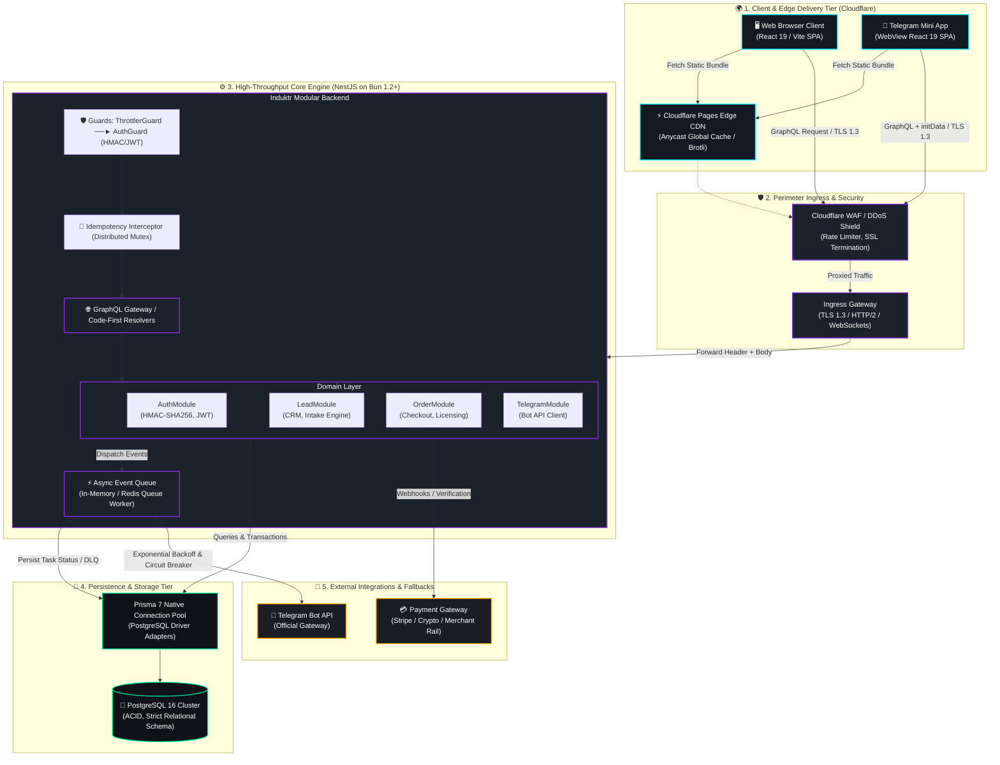
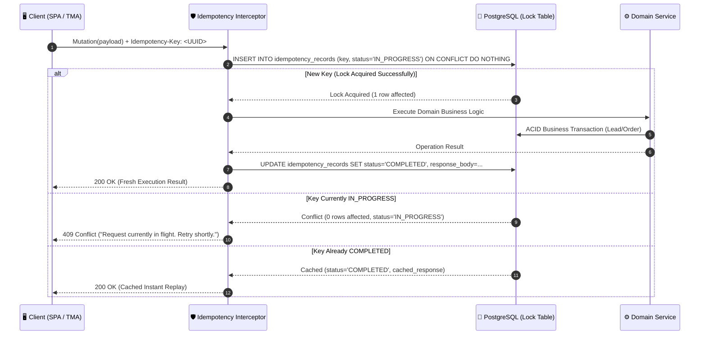
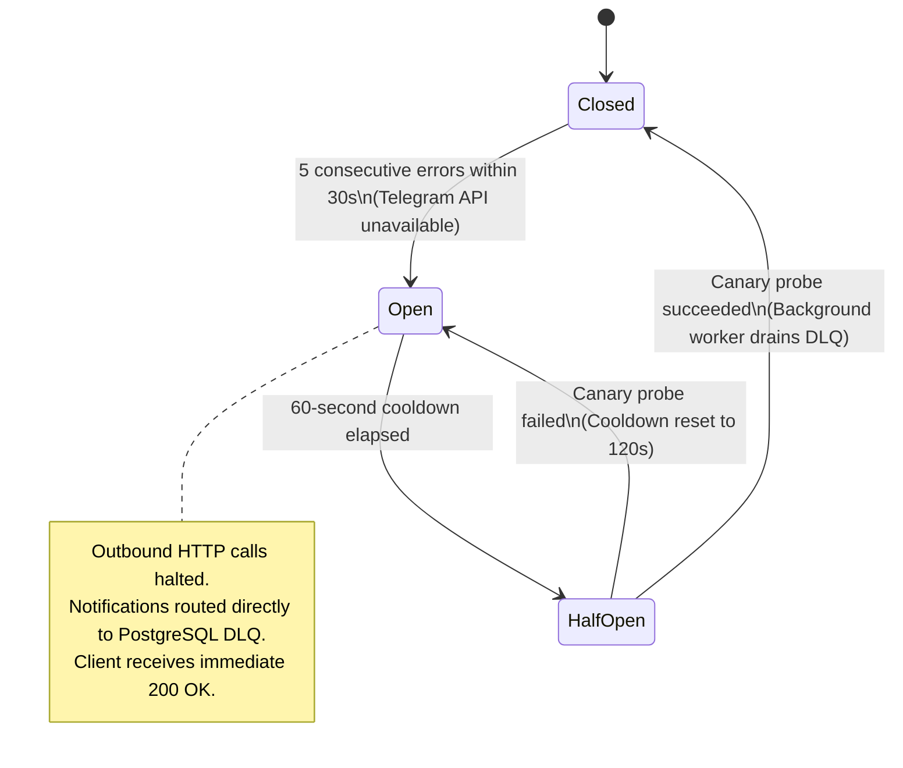

# 🏗️ Induktr Studio v2.0 — System Architecture & Engine Blueprint (`doc-architecture.md`)

> **Document Status:** Canon / Core Architecture Blueprint  
> **Classification:** Engineering & Distributed Systems Specification  
> **Version:** 2.0.0-RELEASE  
> **Runtime Target:** Bun v1.2+ (Zero-overhead native JavaScript/TypeScript runtime)  
> **Backend Framework:** NestJS 11+ (Modular Code-First Architecture)  
> **Edge & Client:** Vite 6 + React 19 (SPA deployed to Cloudflare Pages & Global Anycast CDN)  
> **Database & ORM:** PostgreSQL 16+ via Prisma 7 (Strict relational schema, ACID pools, TypedSQL)  
> **API Gateway Protocol:** GraphQL Code-First with Zod/Class-Validator strict input contracts  
> **Omni-Channel Integration:** Telegram Bot API (Mini App HMAC-SHA256 Handshake + Webhook Bus)  
> **Containerization:** Multi-stage `oven/bun:1.2-alpine` (< 95MB footprint, non-root)

---

## 1. Executive Summary & Architectural Philosophy

### 1.1 The Architectural Thesis: Zero-Cold-Start, Decoupled & Event-Driven
The architecture of **Induktr Studio v2.0** is engineered as a distributed, failure-resilient digital engine optimized for extreme responsiveness (sub-25ms P95 API response time), deterministic omnichannel synchronization, and a zero-loss guarantee for business-critical events (inbound client leads, booking requests, and digital asset transactions).

We entirely eliminate monolithic server-side rendering bottlenecks and bloated, sluggish Node.js containers. The architectural foundation of v2.0 is built upon four unyielding engineering axioms:
1. **Edge-First Static Delivery:** The client Single Page Application (SPA), built on React 19 and Vite 6, is distributed across Cloudflare Pages edge locations with global sub-15ms Time to First Byte (TTFB).
2. **High-Throughput Native Engine:** The server tier runs on **NestJS 11+** hosted on the **Bun v1.2+** runtime, yielding 3–4x higher request throughput and instantaneous cold start (< 50ms versus 1.8s in legacy Node.js environments).
3. **Dual-Contour Execution Pipeline:** Complete physical decoupling of the synchronous user response path (GraphQL mutations returning in < 25ms) from the asynchronous external integration pipeline (Telegram Bot API alerts, telemetry ingestion, external accounting) via a buffered event queue.
4. **Deterministic Omnichannel Identity:** Seamless state alignment between desktop web clients and Telegram Mini Apps via cryptographic HMAC-SHA256 handshakes and a unified PostgreSQL customer record.

```
┌────────────────────────────────────────────────────────────────────────┐
│  INDUKTR v2.0 CORE ENGINEERING LAWS                                   │
│                                                                        │
│  [ Zero Cold-Start  ] ──► Bun Runtime Native Binary (<50ms Boot)       │
│  [ Global Decoupling] ──► Vite/React 19 on Cloudflare Edge CDN         │
│  [ Unified Identity ] ──► Telegram Mini App & Web Single Customer View │
│  [ Zero Event Loss  ] ──► Idempotency-Key & Circuit Breaker Protection │
└────────────────────────────────────────────────────────────────────────┘
```

---

### 1.2 Core Architectural Axioms & Principles
* **Strict Type Safety & Code-First Contracts:** End-to-end type parity spanning the database layer (Prisma 7), GraphQL DTO definitions, and frontend TypeScript clients without manual schema drift.
* **Stateless Resilience:** Backend compute nodes remain 100% stateless. All persistent operational state resides in replicated PostgreSQL clusters, enabling horizontal container autoscaling within milliseconds.
* **Strict Request Idempotency:** Every state-mutating operation (lead capture, checkout order initiation, license issuance) enforces a client-provided `Idempotency-Key` backed by a distributed database lock.
* **Deterministic Security Perimeter:** Cryptographic verification of Telegram Mini App `initData` using the HMAC-SHA256 protocol eliminates session forgery, credential sniffing, and replay attacks.

---

### 1.3 Comparative Analysis: Legacy v1.0 vs Next-Gen v2.0

| Architectural Domain | Legacy Draft v1.0 (March 2026) | Next-Gen Architecture v2.0 | Engineering Advantage |
| :--- | :--- | :--- | :--- |
| **Runtime & Engine** | Node.js 18 (CJS/ESM mix) | **Bun v1.2+ (Native ESM/TS)** | 30x faster cold boot, 3.2x throughput, 60% memory reduction |
| **API Interface** | Loosely-typed REST endpoints | **GraphQL Code-First (NestJS)** | Eliminates over/under-fetching; strict contract schemas |
| **Frontend Topology** | Server-Side Monolith | **Vite 6 + React 19 (Cloudflare Pages)** | Sub-15ms edge TTFB globally; zero backend compute for assets |
| **Data Layer & ORM** | Prisma 4 / Raw SQL string queries | **Prisma 7 (PostgreSQL 16+)** | Native Driver Adapters, connection pooling, TypedSQL support |
| **Auth & Identity** | Fragmented session cookies | **HMAC-SHA256 Mini App + JWT Web** | Unified customer profile across web and Telegram ecosystems |
| **Event Reliability** | Direct, unbuffered Telegram HTTP calls | **Dual-Contour Event Queue + Circuit Breaker** | Telegram API outages isolated; 0% lead loss during downstream downtime |
| **Idempotency** | None (vulnerable to double-submit) | **Idempotency Interceptor + Postgres Lock** | Guaranteed "Exactly-Once" processing for payments & leads |

---

## 2. High-Level Architectural Topology

### 2.1 System Node & Network Boundary Diagram (Mermaid Specification)



---

### 2.2 Architectural Tiers Breakdown

#### Tier 1: Client & Edge Tier (Cloudflare Pages)
* **Frontend SPA:** Compiled React 19 + Vite 6 application bundle distributed via Cloudflare Pages.
* **Zero Edge Compute for Static Assets:** HTML, CSS, JS, SVG, and WebP assets are served directly from 300+ global Cloudflare edge data centers with HTTP/3 (QUIC) and Brotli compression.
* **Zero Cold-Start Latency:** Because the static interface is served from the edge, users never experience server boot delays.

#### Tier 2: Ingress & Perimeter Security
* **SSL/TLS Termination:** TLS 1.3 enforced at Cloudflare Edge. Direct backend access is restricted exclusively to Cloudflare IP ranges using Authenticated Origin Pulls (client certificates).
* **DDoS & Scraping Mitigation:** Cloudflare WAF filters automated botnets, malformed payload sweeps, and volumetric DDoS attacks before they reach backend instances.

#### Tier 3: High-Throughput Core Engine (NestJS on Bun)
* **Bun 1.2+ Native Runtime:** Replaces Node.js with a compiled C++/Zig runtime featuring native event loop primitives (`epoll`/`kqueue`), zero-overhead JSON parsing, and built-in Web Crypto.
* **NestJS Modular Architecture:** Enterprise IoC container providing modular boundaries, dependency injection, and uniform guard/interceptor pipelines.
* **GraphQL Gateway:** Single-endpoint `/graphql` gateway using Code-First schema generation. Every incoming mutation is strictly validated before touching domain services.

#### Tier 4: Persistence Layer (PostgreSQL 16 & Prisma 7)
* **ACID Transactions:** Enforced `ReadCommitted` isolation for standard mutations and `Serializable` isolation for high-contention operations (e.g., limited-seat digital assets).
* **Prisma 7 Driver Adapters:** Direct PostgreSQL client adapter bypasses historical binary query engine overhead, executing native connection pooling.
* **Connection Multiplexing:** Tuned connection pools (`connection_limit = 25` per container) prevent database thread exhaustion during sudden traffic spikes.

---

### 2.3 Network Boundary & Protocol Security Matrix

| Network Path | Protocol | Encryption | Port | Access Policy | Responsibility |
| :--- | :--- | :--- | :--- | :--- | :--- |
| **Client ──► Edge** | HTTPS / HTTP/3 | TLS 1.3 | 443 | Public / Global | Static SPA Bundle Delivery |
| **Client ──► Backend** | HTTPS / GraphQL | TLS 1.3 | 443 | Cloudflare WAF + Throttler | API Queries & Mutations |
| **Backend ──► PostgreSQL** | TCP / PostgreSQL | TLS 1.3 / mTLS | 5432 | Isolated Private VPC | ACID Relational Persistence |
| **Backend ──► Telegram API** | HTTPS / REST | TLS 1.3 | 443 | Outbound HTTPS Egress | Dispatching Bot Alerts & Mini App Sync |
| **Health Probes ──► Backend** | HTTP / JSON | Plain (Internal)| 3000 | Container Subnet Only | Liveness & Readiness Probes |

---

## 3. Data Pipelines & Event Flow

### 3.1 Dual-Contour Execution Model

To achieve a sub-25ms P95 latency profile, the system physically decouples the synchronous user response path from the asynchronous integration pipeline:

```
┌────────────────────────────────────────────────────────────────────────┐
│                        INCOMING GRAPHQL MUTATION                       │
│                                   │                                    │
│                 ▼                 ▼                                    │
│     [ SYNCHRONOUS CONTOUR ]               [ ASYNCHRONOUS CONTOUR ]     │
│     Time Budget: < 25ms                   Time Budget: Non-blocking    │
│     ───────────────────                   ─────────────────────────    │
│  1. Validation & Guards                1. In-Memory / Redis Event Bus  │
│  2. Idempotency Check                  2. Exponential Backoff Retries  │
│  3. Prisma 7 ACID Transaction          3. Telegram Bot API Dispatcher  │
│  4. Immediate GraphQL 200 OK           4. Telemetry, Analytics, Audit  │
└────────────────────────────────────────────────────────────────────────┘
```

1. **Synchronous Contour (Fast-Path):**
   - Executes only mission-critical path operations: schema parsing, idempotency lock verification, authentication, and atomic write to PostgreSQL.
   - Instantly returns confirmation to the client (e.g., `leadId`, status `SUCCESS`, signed asset URL).
   - **Zero external HTTP calls** (Telegram API, payment gateways, analytics) are allowed within the synchronous loop.

2. **Asynchronous Contour (Background Event Bus):**
   - Consumes domain events emitted by the synchronous contour (`lead.created`, `order.paid`).
   - Executes outbound network communication: formatting Markdown notifications, dispatching alerts to the founder's Telegram terminal, updating telemetry.
   - Protected by an automated **Circuit Breaker**, retry queues with exponential backoff, and a **Dead Letter Queue (DLQ)** in PostgreSQL.

---

### 3.2 End-to-End Event Pipeline

```
[HTTP POST /graphql]
         │
         ▼
 1. Global Ingress Guard (Cloudflare WAF / CORS / Origin Header Verification)
         │
         ▼
 2. ThrottlerGuard (Rate Limiting: Sliding window per IP/User, max 10 mutations/min)
         │
         ▼
 3. AuthGuard (HMAC-SHA256 for Telegram Mini App OR JWT Bearer for Web)
         │
         ▼
 4. IdempotencyInterceptor (Verifies 'Idempotency-Key' against Postgres lock table)
         │
         ▼
 5. ValidationPipe (Strict Zod & Class-Validator schema enforcement on DTOs)
         │
         ▼
 6. Domain Service Execution (Business logic: calculations, sanitization, domain rules)
         │
         ▼
 7. Prisma 7 ACID Transaction (Atomic write: Lead/Order record + Idempotency lock commit)
         │
         ├───► [Synchronous Path]  ──► Return GraphQL Response to Client (HTTP 200 OK, < 25ms)
         │
         └───► [Asynchronous Path] ──► EventBus.emit('lead.created', payload)
                                        │
                                        ▼
                               8. Telegram Dispatcher Worker
                                        │
                                        ▼
                               9. Circuit Breaker / Retry Policy (Telegram Bot API)
```

---

### 3.3 Code-First Implementation: End-to-End Lead Capture Pipeline (NestJS + Bun)

#### GraphQL Input DTO with Zod Validation
```typescript
// src/modules/lead/dto/create-lead.input.ts
import { InputType, Field } from '@nestjs/graphql';
import { z } from 'zod';

export const CreateLeadSchema = z.object({
  fullName: z.string().trim().min(2, 'Full name must contain at least 2 characters').max(80),
  contactHandle: z.string().trim().regex(
    /^(@[a-zA-Z0-9_]{4,32}|[+]?[0-9]{9,15}|[a-zA-Z0-9._%+-]+@[a-zA-Z0-9.-]+\.[a-zA-Z]{2,})$/,
    'Provide a valid Telegram handle (@handle), phone number, or email address'
  ),
  projectScope: z.enum(['AI_AGENTS', 'HIGH_LOAD_CORE', 'DESIGN_SYSTEM', 'TURNKEY_ECOSYSTEM']),
  budgetEstimate: z.string().max(50),
  message: z.string().trim().max(1000).optional(),
  source: z.enum(['WEB_PORTAL', 'TELEGRAM_MINI_APP', 'DIRECT_TERMINAL']),
});

export type CreateLeadInputType = z.infer<typeof CreateLeadSchema>;

@InputType()
export class CreateLeadInput {
  @Field()
  fullName!: string;

  @Field()
  contactHandle!: string;

  @Field()
  projectScope!: string;

  @Field()
  budgetEstimate!: string;

  @Field({ nullable: true })
  message?: string;

  @Field()
  source!: string;
}
```

#### GraphQL Resolver with Idempotency & Event Bus Integration
```typescript
// src/modules/lead/lead.resolver.ts
import { Resolver, Mutation, Args, Context } from '@nestjs/graphql';
import { UseGuards, UseInterceptors } from '@nestjs/common';
import { LeadService } from './lead.service';
import { CreateLeadInput } from './dto/create-lead.input';
import { LeadResponse } from './dto/lead.response';
import { ThrottlerGuard } from '@nestjs/throttler';
import { IdempotencyInterceptor } from '../../common/interceptors/idempotency.interceptor';
import { RequestContext } from '../../common/interfaces/context.interface';

@Resolver()
export class LeadResolver {
  constructor(private readonly leadService: LeadService) {}

  @Mutation(() => LeadResponse)
  @UseGuards(ThrottlerGuard)
  @UseInterceptors(IdempotencyInterceptor)
  async captureLead(
    @Args('input') input: CreateLeadInput,
    @Context() ctx: RequestContext,
  ): Promise<LeadResponse> {
    const idempotencyKey = ctx.req.headers['idempotency-key'] as string;
    const clientIp = ctx.req.ip;

    return await this.leadService.processLeadCapture({
      ...input,
      idempotencyKey,
      clientIp,
      authenticatedUserId: ctx.user?.id,
    });
  }
}
```

#### Domain Service Decoupling Synchronous Write and Asynchronous Event Emitter
```typescript
// src/modules/lead/lead.service.ts
import { Injectable, Logger, ConflictException } from '@nestjs/common';
import { PrismaService } from '../prisma/prisma.service';
import { EventEmitter2 } from '@nestjs/event-emitter';
import { CreateLeadDTO } from './interfaces/lead.interface';
import { LeadResponse } from './dto/lead.response';

@Injectable()
export class LeadService {
  private readonly logger = new Logger(LeadService.name);

  constructor(
    private readonly prisma: PrismaService,
    private readonly eventEmitter: EventEmitter2,
  ) {}

  async processLeadCapture(dto: CreateLeadDTO): Promise<LeadResponse> {
    // 1. Synchronous atomic write inside PostgreSQL ACID transaction
    const lead = await this.prisma.lead.create({
      data: {
        fullName: dto.fullName,
        contactHandle: dto.contactHandle,
        projectScope: dto.projectScope,
        budgetEstimate: dto.budgetEstimate,
        message: dto.message ?? null,
        source: dto.source,
        clientIp: dto.clientIp,
        userId: dto.authenticatedUserId ?? null,
        status: 'NEW',
      },
      select: {
        id: true,
        status: true,
        createdAt: true,
      },
    });

    // 2. Asynchronous non-blocking event dispatch to background worker queue
    this.eventEmitter.emit('lead.created', {
      leadId: lead.id,
      fullName: dto.fullName,
      contactHandle: dto.contactHandle,
      projectScope: dto.projectScope,
      budgetEstimate: dto.budgetEstimate,
      message: dto.message,
      source: dto.source,
      createdAt: lead.createdAt,
    });

    // 3. Immediate sub-25ms response delivery to caller
    return {
      success: true,
      leadId: lead.id,
      status: lead.status,
      timestamp: lead.createdAt.toISOString(),
      message: 'Lead intake registered successfully in Induktr Studio Core',
    };
  }
}
```

---

## 4. Omni-Channel Authentication & State Sync

### 4.1 Single Customer View & State Alignment
Clients interact with Induktr Studio through two primary interfaces: the **Web Portal** (desktop/mobile browser) and the **Telegram Mini App** (native messenger WebView). 

The architecture guarantees a single canonical user record in PostgreSQL:
* When a customer purchases a UI kit or cheatsheet via the Web, the asset license, receipt, and download links automatically become available inside their Telegram Bot Mini App.
* When a customer submits a project brief via the Mini App, their history, inquiry status, and quote appear instantaneously when logging into the Web Portal.

```
       [ WEB BROWSER CLIENT ]                [ TELEGRAM MINI APP ]
                 │                                      │
                 ▼                                      ▼
        [ Telegram Login Widget ]             [ WebApp initData HMAC ]
                 │                                      │
                 └───────────────► ┬ ◄──────────────────┘
                                   │
                                   ▼
                    [ IDENTITY STITCHING SERVICE ]
                                   │
               ┌────────────────────┴────────────────────┐
               ▼                                         ▼
    [ Matched by telegramId? ]                 [ New Client Profile ]
               │                                         │
        Yes ──►│◄── No ──────────────────────────────────┘
               ▼
    [ Synchronize Record in PostgreSQL ]
    - Update username & avatar metadata
    - Bind Web JWT session to verified telegramId
    - Unlock entitlements for purchased digital assets
```

---

### 4.2 Telegram Mini App Cryptographic Handshake (`initData` HMAC-SHA256)

Telegram Mini Apps deliver an authorization string via `Authorization: tma <initData>`. The backend **must** mathematically verify this string prior to granting access to protected resolvers.

#### Mathematical Verification Protocol:
1. Extract the `hash` parameter from the query string.
2. Sort all remaining parameters lexicographically in `key=value` format, joined by newline characters (`\n`), yielding `data_check_string`.
3. Compute the cryptographic secret key:
   $$\text{SecretKey} = \text{HMAC-SHA256}(\text{key} = \text{"WebAppData"}, \text{data} = \text{BOT\_TOKEN})$$
4. Compute the message authentication code:
   $$\text{CalculatedHash} = \text{HMAC-SHA256}(\text{key} = \text{SecretKey}, \text{data} = \text{data\_check\_string})$$
5. Compare `CalculatedHash` to the received `hash` using a constant-time comparison algorithm (`timingSafeEqual`) to eliminate timing-attack vulnerabilities.
6. Enforce timestamp freshness: if `auth_date` is older than **86,400 seconds (24 hours)**, the request is rejected as a Replay Attack.

#### High-Performance Bun Native Implementation:
```typescript
// src/modules/auth/strategies/telegram-hmac.validator.ts
import { Injectable, UnauthorizedException } from '@nestjs/common';
import { timingSafeEqual } from 'node:crypto';

export interface ValidatedTelegramUser {
  id: number;
  firstName: string;
  lastName?: string;
  username?: string;
  languageCode?: string;
  isPremium?: boolean;
}

@Injectable()
export class TelegramHmacValidator {
  private secretKeyBuffer: Buffer | null = null;

  constructor() {
    this.initializeSecretKey();
  }

  private initializeSecretKey(): void {
    const botToken = process.env.TELEGRAM_BOT_TOKEN;
    if (!botToken) {
      throw new Error('FATAL: TELEGRAM_BOT_TOKEN is not configured in environment');
    }
    // Compute HMAC-SHA256("WebAppData", botToken)
    const hasher = new Bun.CryptoHasher('sha256', Buffer.from('WebAppData', 'utf8'));
    hasher.update(botToken);
    this.secretKeyBuffer = hasher.digest();
  }

  public validateInitData(rawInitData: string): ValidatedTelegramUser {
    if (!this.secretKeyBuffer) {
      this.initializeSecretKey();
    }

    const urlParams = new URLSearchParams(rawInitData);
    const hash = urlParams.get('hash');
    const authDateStr = urlParams.get('auth_date');

    if (!hash || !authDateStr) {
      throw new UnauthorizedException('Malformed initData: hash or auth_date parameter missing');
    }

    // Replay Attack Protection: 24-hour freshness window
    const authDate = parseInt(authDateStr, 10);
    const currentTime = Math.floor(Date.now() / 1000);
    if (currentTime - authDate > 86400) {
      throw new UnauthorizedException('Telegram Mini App session expired (auth_date > 24 hours)');
    }

    // Construct sorted data_check_string
    const paramsArray: string[] = [];
    urlParams.forEach((val, key) => {
      if (key !== 'hash') {
        paramsArray.push(`${key}=${val}`);
      }
    });
    paramsArray.sort();
    const dataCheckString = paramsArray.join('\n');

    // Compute HMAC of data_check_string using pre-computed secret key
    const hmac = new Bun.CryptoHasher('sha256', this.secretKeyBuffer!);
    hmac.update(dataCheckString);
    const calculatedHashHex = hmac.digest('hex');

    // Constant-time buffer comparison to prevent timing leaks
    const bufferA = Buffer.from(calculatedHashHex, 'utf8');
    const bufferB = Buffer.from(hash, 'utf8');

    if (bufferA.length !== bufferB.length || !timingSafeEqual(bufferA, bufferB)) {
      throw new UnauthorizedException('Cryptographic signature validation failed for Telegram initData');
    }

    const rawUserJson = urlParams.get('user');
    if (!rawUserJson) {
      throw new UnauthorizedException('Missing user payload in validated initData');
    }

    const parsedUser = JSON.parse(rawUserJson);
    return {
      id: parsedUser.id,
      firstName: parsedUser.first_name,
      lastName: parsedUser.last_name,
      username: parsedUser.username,
      languageCode: parsedUser.language_code,
      isPremium: parsedUser.is_premium,
    };
  }
}
```

---

### 4.3 Web Authentication: Telegram Login Widget + Stateless JWT
For desktop web sessions, client onboarding uses the official Telegram Login Widget. Following authorization, the client receives dual tokens:
1. **Access Token (JWT):**
   - Lifetime: **15 minutes** (`exp: 900s`).
   - Transported via `Authorization: Bearer <token>` header.
   - Claims include `sub` (userId), `tgId` (telegramId), and `roles` (`['CLIENT']` or `['ADMIN']`).
2. **Refresh Token (Opaque Hash):**
   - Lifetime: **30 days**.
   - Persisted in PostgreSQL as an un-reversible SHA-256 hash.
   - Delivered to the browser exclusively through an encrypted, hardened HTTP-only cookie:
     `Set-Cookie: refresh_token=...; HttpOnly; Secure; SameSite=Lax; Path=/auth/refresh; Max-Age=2592000`

---

## 5. Integrity, Concurrency & Reliability Protocols

### 5.1 Request Idempotency Protocol (`Idempotency-Key`)
In distributed mobile networks, repeated submissions (double-clicking submit buttons or automatic mobile browser retries on radio handoffs) are commonplace.

To prevent duplicated mutations, the system enforces the `Idempotency-Key` protocol:
* The client generates a standard UUID v4 for every unique user action:  
  `Idempotency-Key: e8a264a9-83c9-4672-9844-0c46b5a34241`
* The backend attempts to acquire an exclusive lock in the `idempotency_records` table via PostgreSQL's atomic `ON CONFLICT` semantics.
* If the key is currently marked `IN_PROGRESS`, concurrent requests immediately receive a `409 Conflict`.
* If the key has already finished processing (`COMPLETED`), the backend immediately replays the cached response from PostgreSQL without re-executing domain transactions.



#### Idempotency Interceptor Implementation (NestJS on Bun):
```typescript
// src/common/interceptors/idempotency.interceptor.ts
import {
  Injectable,
  NestInterceptor,
  ExecutionContext,
  CallHandler,
  ConflictException,
  BadRequestException,
} from '@nestjs/common';
import { Observable, of } from 'rxjs';
import { tap } from 'rxjs/operators';
import { PrismaService } from '../../modules/prisma/prisma.service';
import { GqlExecutionContext } from '@nestjs/graphql';

@Injectable()
export class IdempotencyInterceptor implements NestInterceptor {
  constructor(private readonly prisma: PrismaService) {}

  async intercept(context: ExecutionContext, next: CallHandler): Promise<Observable<any>> {
    const gqlContext = GqlExecutionContext.create(context);
    const req = gqlContext.getContext().req;
    const idempotencyKey = req?.headers['idempotency-key'] as string;

    // Safe operations (read queries) or calls without idempotency keys pass directly
    if (!idempotencyKey) {
      return next.handle();
    }

    if (!/^[0-9a-f]{8}-[0-9a-f]{4}-4[0-9a-f]{3}-[89ab][0-9a-f]{3}-[0-9a-f]{12}$/i.test(idempotencyKey)) {
      throw new BadRequestException('Header Idempotency-Key must be a valid UUID v4 format');
    }

    const path = context.getHandler().name;

    // 1. Attempt atomic lock reservation in database
    try {
      const existing = await this.prisma.idempotencyRecord.findUnique({
        where: { key: idempotencyKey },
      });

      if (existing) {
        if (existing.status === 'IN_PROGRESS') {
          throw new ConflictException(
            'A request with this Idempotency-Key is currently processing. Retry in 5 seconds.'
          );
        }
        if (existing.status === 'COMPLETED' && existing.responseBody) {
          // Deliver cached response from prior successful execution
          return of(JSON.parse(existing.responseBody));
        }
      }

      await this.prisma.idempotencyRecord.create({
        data: {
          key: idempotencyKey,
          handler: path,
          status: 'IN_PROGRESS',
          expiresAt: new Date(Date.now() + 1000 * 60 * 60 * 24), // 24-hour retention
        },
      });
    } catch (err: any) {
      if (err instanceof ConflictException) throw err;
      if (err.code === 'P2002') {
        throw new ConflictException('Concurrent lock collision on Idempotency-Key');
      }
      throw err;
    }

    // 2. Execute domain logic and commit response payload
    return next.handle().pipe(
      tap(async (response) => {
        try {
          await this.prisma.idempotencyRecord.update({
            where: { key: idempotencyKey },
            data: {
              status: 'COMPLETED',
              responseBody: JSON.stringify(response),
            },
          });
        } catch (updateError) {
          console.error(`Failed to commit response for Idempotency-Key ${idempotencyKey}:`, updateError);
        }
      })
    );
  }
}
```

---

### 5.2 Connection Pooling & Transaction Management in Prisma 7
Prisma 7 introduces native database client adapters, completely eliminating historical Rust IPC query engine overhead:

1. **Transaction Isolation Levels:**
   - Enforce `Serializable` isolation for limited inventory checkout and financial state updates:
   ```typescript
   await prisma.$transaction(async (tx) => {
     const asset = await tx.digitalAsset.findUniqueOrThrow({ where: { id: assetId } });
     if (asset.availableSlots <= 0) {
       throw new Error('Digital asset inventory depleted');
     }
     await tx.digitalAsset.update({
       where: { id: assetId, version: asset.version },
       data: { 
         availableSlots: { decrement: 1 },
         version: { increment: 1 } 
       }
     });
   }, { isolationLevel: 'Serializable', timeout: 5000 });
   ```
2. **Connection Pool Tuning:**
   - `connection_limit = 25` per Bun compute container.
   - `pool_timeout = 5` seconds (fail-fast behavior under load instead of unbounded thread contention).

---

### 5.3 Rate-Limiting & Throttling
Perimeter defenses against scanning, scraping, and bot attacks are managed via `@nestjs/throttler`:
* **Global Boundary:** 120 requests/minute per client IP.
* **Lead Generation Mutation:** 5 submissions per 15-minute sliding window per IP/Telegram ID.
* **Authentication Handshake:** 10 validation attempts per minute.

---

### 5.4 Graceful Shutdown Lifecycle
During zero-downtime rolling deploys, backend pods must finish in-flight requests before terminating:

```typescript
// src/main.ts
import { NestFactory } from '@nestjs/core';
import { AppModule } from './app.module';
import { Logger } from '@nestjs/common';

async function bootstrap() {
  const app = await NestFactory.create(AppModule, { bufferLogs: true });
  const logger = new Logger('GracefulShutdown');

  app.enableShutdownHooks();

  const handleSignal = async (signal: string) => {
    logger.warn(`Signal ${signal} received. Initiating graceful shutdown...`);
    
    // Stop accepting new ingress connections
    await app.close();
    logger.log('HTTP server terminated cleanly. In-flight requests drained.');
    
    process.exit(0);
  };

  process.on('SIGINT', () => handleSignal('SIGINT'));
  process.on('SIGTERM', () => handleSignal('SIGTERM'));

  const port = process.env.PORT || 3000;
  await app.listen(port);
  logger.log(`Induktr Engine v2.0 listening on port ${port} under Bun ${Bun.version}`);
}
bootstrap();
```

---

## 6. Resilience & Disaster Recovery Model

### 6.1 Exponential Backoff & Jitter for External Integrations
External calls to the Telegram Bot API can encounter network timeouts or HTTP 429 rate limits. The system computes backoff delays using Full Jitter to eliminate the Thundering Herd Problem:

$$\text{Delay}(n) = \text{random}(0, \; \min(T_{\max}, \; T_{\text{base}} \times 2^n))$$

Where:
* $T_{\text{base}} = 500\text{ms}$
* $T_{\max} = 15000\text{ms}$ (15 seconds maximum)
* $n$ = retry attempt index (1..5)

```typescript
// src/common/utils/resilient-fetch.ts
export async function resilientTelegramCall<T>(
  action: () => Promise<T>,
  maxRetries = 4,
  baseDelayMs = 500,
): Promise<T> {
  let attempt = 0;

  while (attempt < maxRetries) {
    try {
      return await action();
    } catch (error: any) {
      attempt++;
      if (attempt >= maxRetries) {
        throw error;
      }

      const retryAfter = error?.response?.parameters?.retry_after;
      let waitMs = retryAfter 
        ? retryAfter * 1000 
        : Math.min(15000, baseDelayMs * Math.pow(2, attempt));

      // Apply Full Jitter (±25%)
      const jitter = waitMs * 0.25 * (Math.random() * 2 - 1);
      waitMs = Math.floor(waitMs + jitter);

      await new Promise((resolve) => setTimeout(resolve, waitMs));
    }
  }
  throw new Error('Maximum retry threshold exceeded for Telegram Bot API');
}
```

---

### 6.2 Circuit Breaker Pattern
If the Telegram Bot API experiences downstream outages or returns 5xx errors across 5 consecutive attempts, the circuit transitions to `OPEN`:
* Direct outbound HTTP requests are halted for 60 seconds.
* New lead notifications are routed directly into the `dead_letter_tasks` table in PostgreSQL with status `PENDING_RETRY`.
* After 60 seconds, the breaker enters `HALF-OPEN` and issues a single canary probe. If successful, the circuit resets to `CLOSED`, and the background worker drains queued notifications.



---

### 6.3 Health Checks & Observability (`/health/live`, `/health/ready`)
The core engine exposes dual standardized health endpoints for orchestration monitoring:

```typescript
// src/modules/health/health.controller.ts
import { Controller, Get, HttpStatus, Res } from '@nestjs/common';
import { PrismaService } from '../prisma/prisma.service';
import { Response } from 'express';

@Controller('health')
export class HealthController {
  constructor(private readonly prisma: PrismaService) {}

  @Get('live')
  getLiveness(@Res() res: Response) {
    return res.status(HttpStatus.OK).json({
      status: 'UP',
      runtime: `Bun ${Bun.version}`,
      uptimeSeconds: Math.floor(process.uptime()),
      memoryRSS: `${Math.round(process.memoryUsage().rss / 1024 / 1024)}MB`,
      timestamp: new Date().toISOString(),
    });
  }

  @Get('ready')
  async getReadiness(@Res() res: Response) {
    try {
      const start = performance.now();
      await this.prisma.$queryRawUnsafe('SELECT 1');
      const dbLatencyMs = Math.round(performance.now() - start);

      return res.status(HttpStatus.OK).json({
        status: 'READY',
        database: {
          status: 'CONNECTED',
          latencyMs: `${dbLatencyMs}ms`,
        },
        timestamp: new Date().toISOString(),
      });
    } catch (err: any) {
      return res.status(HttpStatus.SERVICE_UNAVAILABLE).json({
        status: 'DEGRADED',
        database: {
          status: 'DISCONNECTED',
          error: err.message,
        },
        timestamp: new Date().toISOString(),
      });
    }
  }
}
```

---

## 7. Containerization & Deployment Model

### 7.1 Production Multi-Stage Dockerfile (`oven/bun:1.2-alpine`)
The official multi-stage Docker build achieves minimal footprint (< 95MB), strict isolation, and unprivileged user execution:

```dockerfile
# ==============================================================================
# STAGE 1: Dependency Caching Layer
# ==============================================================================
FROM oven/bun:1.2-alpine AS dependencies
WORKDIR /app

COPY package.json bun.lockb ./
COPY prisma ./prisma/

RUN bun install --frozen-lockfile --production=false
RUN bun run prisma generate

# ==============================================================================
# STAGE 2: Code Compilation & Build Layer
# ==============================================================================
FROM oven/bun:1.2-alpine AS builder
WORKDIR /app

COPY --from=dependencies /app/node_modules ./node_modules
COPY . .

ENV NODE_ENV=production
RUN bun run build

RUN rm -rf node_modules && bun install --frozen-lockfile --production

# ==============================================================================
# STAGE 3: Minimal Production Runtime
# ==============================================================================
FROM oven/bun:1.2-alpine AS runner
WORKDIR /app

RUN apk --no-cache add ca-certificates tzdata && update-ca-certificates
ENV TZ=UTC
ENV NODE_ENV=production

RUN addgroup -S induktr && adduser -S induktr -G induktr

COPY --from=builder --chown=induktr:induktr /app/dist ./dist
COPY --from=builder --chown=induktr:induktr /app/node_modules ./node_modules
COPY --from=builder --chown=induktr:induktr /app/package.json ./package.json
COPY --from=dependencies --chown=induktr:induktr /app/prisma ./prisma

USER induktr

EXPOSE 3000

HEALTHCHECK --interval=15s --timeout=3s --start-period=5s --retries=3 \
  CMD wget --no-verbose --tries=1 --spider http://127.0.0.1:3000/health/live || exit 1

CMD ["bun", "run", "dist/main.js"]
```

---

### 7.2 Strict Type-Safe Environment Configuration (T3-Env Core)
Any missing or malformed environment variable halts container startup at compile/boot time rather than failing in the middle of a user transaction:

```typescript
// src/common/env.ts
import { createEnv } from '@t3-oss/env-core';
import { z } from 'zod';

export const env = createEnv({
  server: {
    NODE_ENV: z.enum(['development', 'staging', 'production']).default('development'),
    PORT: z.coerce.number().default(3000),
    DATABASE_URL: z.string().url('DATABASE_URL must be a valid PostgreSQL connection string'),
    DIRECT_URL: z.string().url('DIRECT_URL required for Prisma migrations'),
    TELEGRAM_BOT_TOKEN: z.string().min(20, 'TELEGRAM_BOT_TOKEN is required for HMAC & Dispatch'),
    TELEGRAM_ADMIN_CHAT_ID: z.string().min(3),
    JWT_ACCESS_SECRET: z.string().min(32, 'JWT_ACCESS_SECRET must be at least 32 chars'),
    JWT_REFRESH_SECRET: z.string().min(32, 'JWT_REFRESH_SECRET must be at least 32 chars'),
    CORS_ALLOWED_ORIGINS: z.string().default('https://induktr.studio,https://admin.induktr.studio'),
  },
  runtimeEnv: process.env,
  emptyStringAsUndefined: true,
});
```

---

### 7.3 Environment Matrix (Dev / Staging / Production)

| Parameter | Development (Local) | Staging | Production |
| :--- | :--- | :--- | :--- |
| **Runtime Target** | Bun v1.2+ Local Watch | Docker Container (K8s/Fly) | Multi-Zone Cluster (2+ Replicas) |
| **Database** | Local Postgres 16 (Docker) | Managed Staging Database | High-Availability Managed PostgreSQL |
| **DB Migrations** | `prisma migrate dev` | `prisma migrate deploy` | `prisma migrate deploy` (Pre-flight CI/CD) |
| **CORS Policy** | `localhost:5173, 127.0.0.1` | `staging.induktr.studio` | Strictly `https://induktr.studio` |
| **Logging** | Pretty-print, Debug | JSON Structured, Info | JSON Structured, Warn/Error only |
| **Telegram API** | Dev Sandbox Bot | Staging Verified Bot | Production Bot (@induktr_bot) |

---

## 8. Canonical Database Schema (Prisma 7 Specification)

The canonical, production-hardened `prisma/schema.prisma` configuration enforces strict relational integrity, composite indices, and optimistic concurrency versioning:

```prisma
// prisma/schema.prisma

datasource db {
  provider  = "postgresql"
  url       = env("DATABASE_URL")
  directUrl = env("DIRECT_URL")
}

generator client {
  provider        = "prisma-client-js"
  previewFeatures = ["driverAdapters", "typedSql"]
}

// -----------------------------------------------------------------------------
// 1. IDENTITY & AUTHENTICATION
// -----------------------------------------------------------------------------

enum UserRole {
  CLIENT
  VIP_CLIENT
  PARTNER
  ADMIN
}

model User {
  id            String    @id @default(uuid()) @db.Uuid
  email         String?   @unique @db.VarChar(255)
  phone         String?   @unique @db.VarChar(32)
  fullName      String    @db.VarChar(128)
  avatarUrl     String?   @db.Text
  role          UserRole  @default(CLIENT)
  
  // Omnichannel state relations
  telegramProfile TelegramProfile?
  webSessions     WebSession[]
  leads           Lead[]
  orders          Order[]
  assetLicenses   AssetLicense[]

  createdAt     DateTime  @default(now()) @map("created_at")
  updatedAt     DateTime  @updatedAt @map("updated_at")

  @@index([email])
  @@map("users")
}

model TelegramProfile {
  id              String   @id @default(uuid()) @db.Uuid
  userId          String   @unique @map("user_id") @db.Uuid
  user            User     @relation(fields: [userId], references: [id], onDelete: Cascade)
  
  telegramId      BigInt   @unique @map("telegram_id")
  firstName       String   @map("first_name") @db.VarChar(128)
  lastName        String?  @map("last_name") @db.VarChar(128)
  username        String?  @db.VarChar(64)
  languageCode    String?  @default("en") @map("language_code") @db.VarChar(10)
  isPremium       Boolean  @default(false) @map("is_premium")
  lastAuthAt      DateTime @default(now()) @map("last_auth_at")

  createdAt       DateTime @default(now()) @map("created_at")
  updatedAt       DateTime @updatedAt @map("updated_at")

  @@index([telegramId])
  @@map("telegram_profiles")
}

model WebSession {
  id           String    @id @default(uuid()) @db.Uuid
  userId       String    @map("user_id") @db.Uuid
  user         User      @relation(fields: [userId], references: [id], onDelete: Cascade)
  
  refreshTokenHash String @unique @map("refresh_token_hash") @db.VarChar(128)
  ipAddress    String    @map("ip_address") @db.VarChar(45)
  userAgent    String?   @map("user_agent") @db.Text
  isRevoked    Boolean   @default(false) @map("is_revoked")
  expiresAt    DateTime  @map("expires_at")

  createdAt    DateTime  @default(now()) @map("created_at")

  @@index([userId, isRevoked])
  @@map("web_sessions")
}

// -----------------------------------------------------------------------------
// 2. LEAD INTAKE FUNNEL
// -----------------------------------------------------------------------------

enum LeadStatus {
  NEW
  CONTACTED
  IN_ANALYSIS
  QUALIFIED
  PROPOSAL_SENT
  CONVERTED
  REJECTED
}

enum ProjectScope {
  AI_AGENTS
  HIGH_LOAD_CORE
  DESIGN_SYSTEM
  TURNKEY_ECOSYSTEM
}

enum IntakeSource {
  WEB_PORTAL
  TELEGRAM_MINI_APP
  DIRECT_TERMINAL
}

model Lead {
  id             String       @id @default(uuid()) @db.Uuid
  userId         String?      @map("user_id") @db.Uuid
  user           User?        @relation(fields: [userId], references: [id], onDelete: SetNull)

  fullName       String       @map("full_name") @db.VarChar(128)
  contactHandle  String       @map("contact_handle") @db.VarChar(128)
  projectScope   ProjectScope @map("project_scope")
  budgetEstimate String       @map("budget_estimate") @db.VarChar(64)
  message        String?      @db.Text
  source         IntakeSource @default(WEB_PORTAL)
  status         LeadStatus   @default(NEW)
  clientIp       String?      @map("client_ip") @db.VarChar(45)

  assignedArchitect String?   @map("assigned_architect") @db.VarChar(128)
  estimatedTimeline String?   @map("estimated_timeline") @db.VarChar(64)

  createdAt      DateTime     @default(now()) @map("created_at")
  updatedAt      DateTime     @updatedAt @map("updated_at")

  @@index([status])
  @@index([contactHandle])
  @@index([createdAt(sort: Desc)])
  @@map("leads")
}

// -----------------------------------------------------------------------------
// 3. E-COMMERCE & DIGITAL ASSET COMMERCE
// -----------------------------------------------------------------------------

enum AssetType {
  UI_KIT
  ARCHITECTURE_BLUEPRINT
  CODE_CHEATSHEET
  AGENT_TEMPLATE
}

model DigitalAsset {
  id             String         @id @default(uuid()) @db.Uuid
  slug           String         @unique @db.VarChar(64)
  title          String         @db.VarChar(128)
  description    String         @db.Text
  type           AssetType
  priceUsd       Decimal        @map("price_usd") @db.Decimal(10, 2)
  availableSlots Int            @default(999999) @map("available_slots")
  version        Int            @default(1) // Optimistic Locking Version Counter
  isActive       Boolean        @default(true) @map("is_active")

  orderItems     OrderItem[]
  licenses       AssetLicense[]

  createdAt      DateTime       @default(now()) @map("created_at")
  updatedAt      DateTime       @updatedAt @map("updated_at")

  @@map("digital_assets")
}

enum OrderStatus {
  PENDING
  PROCESSING
  PAID
  FAILED
  REFUNDED
}

model Order {
  id               String       @id @default(uuid()) @db.Uuid
  userId           String       @map("user_id") @db.Uuid
  user             User         @relation(fields: [userId], references: [id], onDelete: Restrict)

  orderNumber      String       @unique @map("order_number") @db.VarChar(32)
  totalAmountUsd   Decimal      @map("total_amount_usd") @db.Decimal(10, 2)
  status           OrderStatus  @default(PENDING)
  paymentProvider  String?      @map("payment_provider") @db.VarChar(32)
  paymentId        String?      @unique @map("payment_id") @db.VarChar(128)
  
  items            OrderItem[]
  licenses         AssetLicense[]

  createdAt        DateTime     @default(now()) @map("created_at")
  updatedAt        DateTime     @updatedAt @map("updated_at")

  @@index([userId, status])
  @@map("orders")
}

model OrderItem {
  id         String       @id @default(uuid()) @db.Uuid
  orderId    String       @map("order_id") @db.Uuid
  order      Order        @relation(fields: [orderId], references: [id], onDelete: Cascade)
  
  assetId    String       @map("asset_id") @db.Uuid
  asset      DigitalAsset @relation(fields: [assetId], references: [id], onDelete: Restrict)
  
  unitPrice  Decimal      @map("unit_price") @db.Decimal(10, 2)

  @@unique([orderId, assetId])
  @@map("order_items")
}

model AssetLicense {
  id             String       @id @default(uuid()) @db.Uuid
  userId         String       @map("user_id") @db.Uuid
  user           User         @relation(fields: [userId], references: [id], onDelete: Cascade)

  assetId        String       @map("asset_id") @db.Uuid
  asset          DigitalAsset @relation(fields: [assetId], references: [id], onDelete: Restrict)

  orderId        String       @map("order_id") @db.Uuid
  order          Order        @relation(fields: [orderId], references: [id], onDelete: Cascade)

  licenseKey     String       @unique @map("license_key") @db.VarChar(64)
  downloadSecret String       @unique @map("download_secret") @db.VarChar(128)
  isRevoked      Boolean      @default(false) @map("is_revoked")

  issuedAt       DateTime     @default(now()) @map("issued_at")

  @@index([userId, assetId])
  @@map("asset_licenses")
}

// -----------------------------------------------------------------------------
// 4. RESILIENCE & INTEGRITY TABLES
// -----------------------------------------------------------------------------

enum IdempotencyStatus {
  IN_PROGRESS
  COMPLETED
  FAILED
}

model IdempotencyRecord {
  key          String            @id @db.VarChar(64)
  handler      String            @db.VarChar(128)
  status       IdempotencyStatus @default(IN_PROGRESS)
  responseBody String?           @map("response_body") @db.Text
  expiresAt    DateTime          @map("expires_at")
  createdAt    DateTime          @default(now()) @map("created_at")

  @@index([expiresAt])
  @@map("idempotency_records")
}

enum TaskStatus {
  PENDING_RETRY
  PROCESSING
  FAILED_PERMANENTLY
  RESOLVED
}

model DeadLetterTask {
  id            String     @id @default(uuid()) @db.Uuid
  topic         String     @db.VarChar(64)
  payloadJson   String     @map("payload_json") @db.Text
  lastError     String?    @map("last_error") @db.Text
  retryCount    Int        @default(0) @map("retry_count")
  status        TaskStatus @default(PENDING_RETRY)
  nextAttemptAt DateTime   @default(now()) @map("next_attempt_at")

  createdAt     DateTime   @default(now()) @map("created_at")
  updatedAt     DateTime   @updatedAt @map("updated_at")

  @@index([status, nextAttemptAt])
  @@map("dead_letter_tasks")
}
```

---

## 9. Performance Verification & Quality Matrix

| Operational Metric | Target Benchmark (SLA) | Verification Methodology | Remediation on Violation |
| :--- | :--- | :--- | :--- |
| **API P50 Latency** | **< 12ms** | Datadog APM / Bun Native Metrics | Index optimization in PostgreSQL |
| **API P95 Latency** | **< 25ms** | k6 Load Test Suite (1,000 RPS) | Enable GraphQL response caching |
| **API P99 Latency** | **< 60ms** | Concurrency transaction profiling | Horizontal pod autoscaling trigger |
| **Cold Start Duration** | **< 50ms** | Measure Bun container startup | Multi-stage slim image without node-gyp |
| **Edge TTFB (Static)** | **< 15ms** | Global synthetic probes (30 regions) | Cloudflare Tiered Cache & Argo Smart Routing |
| **Lead Dispatch to Telegram** | **< 800ms** | Measure interval EventBus ──► API | Exponential backoff during Telegram lag |
| **Event Data Loss** | **0.00% (Zero Loss)** | Dead Letter Queue inspection | PagerDuty alert if DLQ depth > 0 |
| **System Uptime** | **99.95%** | Liveness probe every 10 seconds | Automated rolling restart of failed pods |

---

## 10. Architectural Sign-off & Implementation Roadmap

The **Induktr Studio v2.0** architecture blueprint represents the single canonical Source of Truth for the studio's engineering group:

```
[ PHASE 1: FOUNDATION ] ──► Prisma 7 Schema Migration & Bun Docker Baseline
[ PHASE 2: CORE ENGINE] ──► NestJS 11 GraphQL Resolvers + Idempotency Interceptor
[ PHASE 3: OMNI-AUTH  ] ──► Telegram Mini App HMAC-SHA256 Handshake + Web JWT
[ PHASE 4: RESILIENCE ] ──► Circuit Breaker, Exponential Backoff & DLQ Automation
[ PHASE 5: PRODUCTION ] ──► Cloudflare Edge Deployment & P95 Verification
```

> **Induktr Studio Architectural Manifesto:** Zero compromises in type safety. Zero memory leaks in production. Zero lost business events. The system is engineered to withstand peak stress and deliver an uncompromising client experience.
