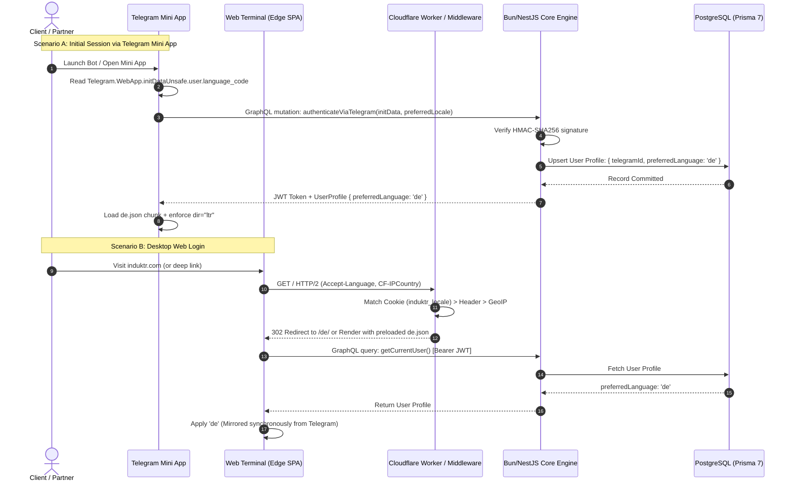

# 🌐 Induktr Studio v2.0 — Global i18n & Localization Protocol (`doc-loc1n.md`)

> **Document Status:** Canon / Core Engineering Specification  
> **Classification:** Internationalization (i18n), Localization (l10n), RTL Spatial Physics & Global Expansion Architecture  
> **Version:** 2.0.0-RELEASE  
> **Target Ecosystem:** Induktr Studio v2.0 (React 19 / Vite 6 / Bun 1.2+ / Cloudflare Pages Edge / Prisma 7)  
> **Supported Strategic Locales:** `en` (Global Tier-1), `ua` (Native Sovereign Core), `de` (DACH Industrial), `ar` (Gulf Tech Capital / RTL), `es` (LatAm & Global Scale)  
> **Studio Tier:** High-Ticket Enterprise Architecture & Autonomous AI Systems ($3,000 – $10,000+)  

---

## 1. Executive Summary & Strategic Locale Matrix (The 5 Global Gateways)

### 1.1 The Strategic Pivot: From Legacy Draft to Global Tier-1 Expansion
In the original draft from March 2026, Induktr Studio's localization topology relied on an outdated triad (UA, EN, RU). As Induktr Studio v2.0 transitions to serving global institutional contracts with deal sizes ranging from **$3,000 to $10,000+** for autonomous AI systems and high-throughput web platforms, that legacy structure has been completely decommissioned.

The studio establishes **5 strategic language gateways**, precisely calibrated to international capital concentrations, executive decision-making hubs (CTOs, founders, fund partners), and sovereign infrastructure priorities:

```
┌──────────────────────────────────────────────────────────────────────────────────┐
│                   INDUKTR v2.0 STRATEGIC GLOBAL LOCALE MATRIX                    │
├─────────┬──────────────────────┬────────────────────────────┬────────────────────┤
│ Locale  │ Strategic Domain     │ Target Audience & Capital  │ Architectural Role │
├─────────┼──────────────────────┼────────────────────────────┼────────────────────┤
│  EN     │ Global Tier-1 Core   │ Silicon Valley, AI Funds   │ Default Lingua     │
│  UA     │ Sovereign Core       │ Founder Root, UA High-Tech │ Native Identity    │
│  DE     │ DACH Heavy Industry  │ Mittelstand, Swiss FinTech │ Zero-Debt & Trust  │
│  AR     │ Gulf Tech Capital    │ UAE / Saudi Sovereign Wealth│ RTL Physics Mastery│
│  ES     │ LatAm & Global Scale │ Fast-Scale Startups, Assets│ Hyper-Distribution │
└─────────┴──────────────────────┴────────────────────────────┴────────────────────┘
```

1. **English (`en` — Global Tier-1 Lingua Franca):**  
   The baseline lingua franca of global technology leadership, Silicon Valley venture firms, European AI syndicates, and international digital contracts. It serves as the canonical contract baseline for the entire platform: all TypeScript compilation keys, type declarations, and fallback chains resolve against `en`.
2. **Ukrainian (`ua` — Native Sovereign Core):**  
   The native language of the founder (Nikita Voitenko / Induktr) and the sovereign foundation of the studio. Directed toward the high-tempo Ukrainian DeepTech, GovTech, DefenseTech, and specialized engineering clusters. Represents rigorous engineering standards and sovereign technological identity.
3. **German (`de` — DACH Region: Germany, Austria, Switzerland):**  
   The industrial and financial powerhouse of continental Europe. DACH-region corporate clients exhibit exceptionally high customer lifetime value (LTV) and strong willingness to invest in structural durability, data privacy (DSGVO/GDPR compliance), stringent SLAs, and zero architectural debt. The German locale communicates precision, reliability, and engineering discipline.
4. **Arabic (`ar` — Gulf Tech Capital: Dubai, Abu Dhabi, Riyadh):**  
   The epicenter of sovereign AI capital, Web3 venture investments, and futuristic gigaprojects. A critical gateway for closing contracts in the $10,000 to $50,000+ bracket. Serves as a live showcase of world-class frontend engineering: native, flawless **RTL (Right-to-Left)** physics without sacrificing 60/120 FPS compositor fluidity.
5. **Spanish (`es` — LatAm & Global Scalability):**  
   The second most spoken native language in the Western hemisphere. Unlocks high-growth technology hubs across Latin America (Mexico, Colombia, Argentina) and Spain, establishing an organic acquisition funnel for the studio's digital engineering assets (architecture cheat sheets, UI systems, React/NestJS core templates).

---

### 1.2 Market, Economic Driver & Cultural Profile Matrix

| Parameter | English (`en`) | Ukrainian (`ua`) | German (`de`) | Arabic (`ar`) | Spanish (`es`) |
| :--- | :--- | :--- | :--- | :--- | :--- |
| **Geographic Focus** | US, UK, Global Remote | Ukraine, CEE Tech Hubs | Germany, Switzerland, Austria | UAE, Saudi Arabia, Qatar | Spain, LatAm, Southern US |
| **Average Deal Size** | $5,000 – $15,000+ | $3,000 – $8,000+ | $7,000 – $20,000+ | $10,000 – $50,000+ | $2,500 – $7,000+ |
| **Primary Purchase Driver** | Time-to-Market, AI ROI | Sovereign Precision, Ownership | Stability, Privacy, ISO/GDPR | Prestige, Mega-Scale, Vision | Rapid Scaling, Ecosystem Agility |
| **Writing Direction** | LTR (Left-to-Right) | LTR (Left-to-Right) | LTR (Left-to-Right) | **RTL (Right-to-Left)** | LTR (Left-to-Right) |
| **Primary Font Stack** | Geist Sans / JetBrains Mono | Geist Sans (Cyrillic) / JetBrains | Geist Sans / JetBrains Mono | **IBM Plex Sans Arabic** / Cairo | Geist Sans / JetBrains Mono |
| **Text Expansion Factor** | 1.00 (Baseline) | 1.05 – 1.15 (+15%) | 1.25 – 1.35 (+35%) | 1.10 – 1.20 (+20%) | 1.20 – 1.30 (+30%) |
| **Tone of Voice Posture** | Pragmatic, metric-driven | Resolute, sovereign precision | Formal (Sie), institutional | Regal, expansive, prestigious | High-tempo, direct, agile |

---

### 1.3 Fundamental Engineering Axioms of i18n
* **Axiom I: Zero-Bundle-Overhead:** No monolithic dictionary tables in the client bundle. The client downloads *only* the active language dictionary as an isolated code-split chunk (< 5KB gzip).
* **Axiom II: Compile-Time Key Enforcement:** The absence of any translation key across the 5 supported languages triggers an immediate compilation failure during `bun run build`. Untranslated raw string keys can never reach production.
* **Axiom III: RTL-First Geometry:** Layouts are authored exclusively with CSS Logical Properties. Toggling `dir="rtl"` requires zero visual hacks and maintains 60/120 FPS compositor stability.
* **Axiom IV: Omnichannel Identity Binding:** The client's preferred language synchronizes seamlessly between Telegram Mini App sessions and Web Portal logins via the user's PostgreSQL profile.
* **Axiom V: Tactical Transcreation over Translation:** No mechanical, literal machine translation. All copy is adapted using tactical negotiation principles (Chris Voss Tactical Empathy) tailored to executive decision-makers.

---

## 2. Zero-Bundle-Overhead i18n & Code-Splitting Architecture

### 2.1 Critique of Legacy Solutions (The Anti-Pattern of Heavy i18n)
Traditional web architectures often rely on bloated runtime suites such as `i18next` + `react-i18next` + `i18next-http-backend`. Within Induktr v2.0's performance budget, this pattern is unacceptable:
1. **Runtime Parsing Overhead:** The interpolation and pluralization engines of heavy i18n libraries consume 45–60KB of minified JavaScript, executing expensive regex runs on the mobile CPU's main thread.
2. **Bundle Bloat:** Embedding multi-language dictionaries in the primary application bundle injects 150–300KB of dead string weight.
3. **Layout Shift & Flash of Untranslated Content (FOUC):** Naive asynchronous HTTP loaders without edge-coordinated hydration cause flickering translation keys (e.g., `hero.title`) during initial page load.

---

### 2.2 Induktr i18n Engine Topology (< 3KB Runtime)
We implement a lightweight, strictly type-safe engine built directly on top of React 19 primitives and native ECMAScript Internationalization APIs (`Intl.PluralRules`, `Intl.NumberFormat`, `Intl.DateTimeFormat`):

```mermaid
flowchart TD
    subgraph ClientBoot ["🚀 Initial Client Boot (Cloudflare Pages)"]
        HTML["index.html (dir='ltr' / lang='en')"]
        Bootstrap["Bootstrap Runtime (<3KB i18n Engine)"]
        LocaleDetect["Language Detector: URL > TG WebApp > Cookie > Navigator"]
    end

    subgraph ChunkLoader ["📦 Async Dynamic Code-Splitting"]
        ChunkEN["en.json (Pre-baked Core)"]
        ChunkUA["ua.json (Lazy Chunk)"]
        ChunkDE["de.json (Lazy Chunk)"]
        ChunkAR["ar.json (Lazy Chunk)"]
        ChunkES["es.json (Lazy Chunk)"]
    end

    subgraph DOMState ["🖥️ Active Application State"]
        ReactContext["React 19 I18nProvider\n(Atomically Loaded Translations)"]
        RTLPhysic["RTL Physics Manager\n(dir attribute, CSS Logical Layout)"]
        FontManager["Dynamic Font Loader\n(IBM Plex Arabic for 'ar')"]
    end

    Bootstrap --> LocaleDetect
    LocaleDetect -->|Match Target Locale| ChunkLoader
    ChunkLoader -->|import('./locales/${lang}.json')| ReactContext
    ReactContext --> RTLPhysic
    ReactContext --> FontManager
```

* **Isolated Dynamic Chunks:** Each locale dictionary is compiled by Vite 6 into an isolated JSON chunk. The initial HTML preloads the active locale via `<link rel="modulepreload">`.
* **Zero External Dependencies:** Zero runtime third-party localization libraries. The entire client pipeline is implemented in under 150 lines of clean TypeScript.
* **Atomic Translation Swapping:** Locale transitions are wrapped in `React.startTransition`, updating layout and content atomically without freezing the main thread or unmounting subtrees.

---

### 2.3 Strict Compile-Time Type Safety & Key Parity
Every dictionary key is verified by the TypeScript compiler. The canonical schema is defined in `en.json`. Any divergence in keys, nesting, or structure produces an immediate build break.

```typescript
// src/shared/i18n/types.ts
export type SupportedLocale = 'en' | 'ua' | 'de' | 'ar' | 'es';

export const SUPPORTED_LOCALES: readonly SupportedLocale[] = ['en', 'ua', 'de', 'ar', 'es'] as const;
export const DEFAULT_LOCALE: SupportedLocale = 'en';

// Recursive type utility extracting dot-notated paths like "hero.cta.primary"
export type NestedKeyOf<ObjectType extends object> = {
  [Key in keyof ObjectType & (string | number)]: ObjectType[Key] extends object
    ? `${Key}.${NestedKeyOf<ObjectType[Key]>}`
    : `${Key}`;
}[keyof ObjectType & (string | number)];

// Canonical translation schema derived directly from en.json
import type schemaEn from './locales/en.json';
export type TranslationSchema = typeof schemaEn;
export type TranslationKey = NestedKeyOf<TranslationSchema>;

// Strict parity type requiring 100% key coverage across all locales
export type LocaleDictionary = {
  [K in keyof TranslationSchema]: TranslationSchema[K];
};
```

---

### 2.4 Native Intl Engine: Pluralization, Numbers, Currencies & Dates
Instead of heavy ICU message parsers, the engine utilizes the standardized **ECMAScript Internationalization API (ECMA-402)** native to all modern browsers and the Bun runtime:

```typescript
// src/shared/i18n/formatters.ts
export class IntlEngine {
  private static pluralRulesCache = new Map<string, Intl.PluralRules>();
  private static numberFormatCache = new Map<string, Intl.NumberFormat>();

  // Currency formatting tailored to regional market conventions
  static formatCurrency(amount: number, locale: SupportedLocale, currency: 'USD' | 'EUR' | 'AED' | 'UAH'): string {
    const key = `${locale}-${currency}`;
    if (!this.numberFormatCache.has(key)) {
      this.numberFormatCache.set(key, new Intl.NumberFormat(locale === 'ua' ? 'uk-UA' : locale, {
        style: 'currency',
        currency,
        maximumFractionDigits: 0,
      }));
    }
    return this.numberFormatCache.get(key)!.format(amount);
  }

  // Native pluralization via Intl.PluralRules (handles complex Slavic forms 1 / 2-4 / 5-0)
  static resolvePluralCategory(count: number, locale: SupportedLocale): Intl.LDMLPluralRule {
    const bcp47 = locale === 'ua' ? 'uk' : locale;
    if (!this.pluralRulesCache.has(bcp47)) {
      this.pluralRulesCache.set(bcp47, new Intl.PluralRules(bcp47));
    }
    return this.pluralRulesCache.get(bcp47)!.select(count);
  }
}
```

---

## 3. RTL-First Spatial Physics & Arabic Typographic Engineering

The Arabic locale (`ar`) is a core technical differentiator demonstrating Induktr Studio's engineering caliber to clients across the UAE and Saudi Arabia. RTL execution requires complete architectural inversion of spatial interface physics.

### 3.1 Physical Coordinates vs. CSS Logical Properties
Physical coordinate properties are strictly prohibited in the styling architecture:

| Prohibited Physical Property | Mandatory Logical CSS Property | Tailwind CSS v4 Utility | LTR Behavior | RTL Behavior |
| :--- | :--- | :--- | :--- | :--- |
| `margin-left` | `margin-inline-start` | `ms-*` | Margin Left | Margin Right |
| `margin-right` | `margin-inline-end` | `me-*` | Margin Right | Margin Left |
| `padding-left` | `padding-inline-start` | `ps-*` | Padding Left | Padding Right |
| `padding-right` | `padding-inline-end` | `pe-*` | Padding Right | Padding Left |
| `left: 0;` | `inset-inline-start: 0;` | `start-0` | Docked Left | Docked Right |
| `right: 0;` | `inset-inline-end: 0;` | `end-0` | Docked Right | Docked Left |
| `text-align: left;` | `text-align: start;` | `text-start` | Align Left | Align Right |
| `border-left` | `border-inline-start` | `border-s-*` | Border Left | Border Right |
| `border-right` | `border-inline-end` | `border-e-*` | Border Right | Border Left |

---

### 3.2 Dynamic Direction Switching & DOM Markup
The root HTML element updates its directionality and language attributes dynamically:

```html
<!-- For LTR Locales (en, ua, de, es) -->
<html lang="en" dir="ltr" class="font-sans">

<!-- For RTL Locales (ar) -->
<html lang="ar" dir="rtl" class="font-arabic">
```

```typescript
// src/shared/i18n/rtl-manager.ts
export function applyDocumentDirection(locale: SupportedLocale): void {
  const isRTL = locale === 'ar';
  const root = document.documentElement;

  root.setAttribute('dir', isRTL ? 'rtl' : 'ltr');
  root.setAttribute('lang', locale === 'ua' ? 'uk' : locale);

  if (isRTL) {
    root.classList.add('rtl-active');
    root.classList.remove('ltr-active');
  } else {
    root.classList.add('ltr-active');
    root.classList.remove('rtl-active');
  }
}
```

---

### 3.3 Directional Icon Mirroring Taxonomy
Not all visual symbols should be mirrored in an RTL layout. Inverting non-directional icons reveals amateur implementation:

```
┌────────────────────────────────────────────────────────────────────────┐
│                   RTL ICON MIRRORING TAXONOMY                          │
├───────────────────────────────────┬────────────────────────────────────┤
│ 🔄 MIRRORED (Directional Flow)    │ 🚫 NOT MIRRORED (Universal Icons)  │
├───────────────────────────────────┼────────────────────────────────────┤
│ • Navigation arrows (→, ←)        │ • Close button (×)                 │
│ • Disclosure chevrons (chevron)   │ • Search magnifying glass (🔍)     │
│ • Progress bars & sequential steps│ • Settings gear (⚙️)               │
│ • "Next" and "Back" action icons  │ • Validation checkmarks (✓)        │
│ • Terminal prompts (`>_`)         │ • Network, battery & Wi-Fi icons   │
│ • Undo / Redo directional controls│ • Data graphs, charts & brand logs │
└───────────────────────────────────┴────────────────────────────────────┘
```

Automated CSS mirroring rule:
```css
/* Mirror only explicitly marked directional icons in RTL mode */
[dir="rtl"] .icon-directional {
  transform: scaleX(-1);
  transform-origin: center;
}
```

---

### 3.4 Arabic Typographic Engineering (Typographic Balance & x-Height)
Arabic calligraphy features fundamentally different vertical metrics compared to Latin letterforms:
1. **Absence of Capitalization:** There is no uppercase Cap Height baseline.
2. **Ascender & Descender Loops:** Diacritical marks (harakat) and calligraphic loops demand increased line height to avoid clipping by adjacent container boxes.
3. **Strict Prohibition of Negative Letter Spacing:** While Latin `Geist Sans` employs `letter-spacing: -0.02em` for dense obsidian aesthetics, applying negative tracking to Arabic destroys character glyph cursive connections.

**Induktr v2.0 Typography Pairing:**
* **LTR Stack (EN, UA, DE, ES):** `Geist Sans` (UI) + `JetBrains Mono` (Telemetry & Code).
* **RTL Stack (AR):** `IBM Plex Sans Arabic` (UI) + `JetBrains Mono` (Isolated LTR Telemetry Blocks).

```css
/* Global Typography Tokens */
@layer base {
  :root {
    --font-ui: 'Geist Sans', -apple-system, BlinkMacSystemFont, sans-serif;
    --font-mono: 'JetBrains Mono', monospace;
  }

  [dir="rtl"] {
    --font-ui: 'IBM Plex Sans Arabic', -apple-system, BlinkMacSystemFont, sans-serif;
    line-height: 1.65;
    letter-spacing: normal !important;
  }
}
```

---

### 3.5 BiDi Isolation for Terminal & Telemetry
Induktr v2.0 features dense system telemetry: CLI terminals, FPS monitors, network latencies, transaction hashes, and code blocks. In the Arabic locale, these technical blocks **must never mirror**, which would corrupt code grammar and numerical meaning.

We enforce strict Bidirectional Isolation (**BiDi isolation**):

```tsx
// Telemetry display component with strict BiDi isolation
export const TelemetryRegister = ({ label, value }: { label: string; value: string }) => {
  return (
    <div className="flex items-center justify-between gap-4 py-1 border-b border-[var(--border-subtle)]">
      {/* Label aligns to the logical inline-start edge and renders in localized Arabic */}
      <span className="text-xs text-[var(--text-secondary)]">{label}</span>
      
      {/* Telemetry metrics remain strictly LTR in monospaced format */}
      <bdi dir="ltr" className="font-mono text-xs font-semibold text-[var(--accent-cyan)] tabular-nums">
        {value}
      </bdi>
    </div>
  );
};
```

---

## 4. Tactical Cultural Adaptation & Tone of Voice Protocol

Induktr Studio rejects generic corporate translations. Copy is structured according to **Chris Voss tactical negotiation principles**: statements demonstrate clear comprehension of executive risks, address technical liabilities head-on, and communicate unshakeable engineering authority.

```
┌────────────────────────────────────────────────────────────────────────┐
│                   TACTICAL LOCALIZATION DIRECTIVES                     │
├─────────┬───────────────────────────┬──────────────────────────────────┤
│ Market  │ Psychology & Power Dynamic│ Voice Posture                    │
├─────────┼───────────────────────────┼──────────────────────────────────┤
│ EN      │ High-Velocity Execution   │ Pragmatic, metrics-first, curt   │
│ UA      │ Sovereign Engineering     │ Precise, resolute, uncompromising│
│ DE      │ Institutional Security    │ Formal (Sie), zero-debt, audited │
│ AR      │ Sovereign Future Vision   │ Regal, expansive, prestigious    │
│ ES      │ Dynamic Hyper-Growth      │ Agile, decisive, high-tempo      │
└─────────┴───────────────────────────┴──────────────────────────────────┘
```

### 4.1 Market Tone Profiles

#### English (`en`): The Silicon Valley Architect
* **Focus:** Deployment velocity, measurable ROI, autonomous multi-agent pipelines, OPEX compression.
* **Style:** Crisp, declarative statements devoid of promotional filler. Precision systems engineering vocabulary.
* *Anti-Pattern:* "We are a creative agency delivering great web experiences."
* *Induktr Canon:* "Production-grade autonomous AI systems and high-throughput web architecture. Sub-15ms edge response. Built for scale."

#### Ukrainian (`ua`): Sovereign Engineering Core
* **Focus:** Uncompromising engineering rigor, architectural sovereignty, total data ownership, system autonomy.
* **Style:** High-register technical precision without loan-word corruptions; authoritative, disciplined tone.
* *Anti-Pattern:* "Ми робимо круті сайти та ботів під ключ недорого."
* *Induktr Canon:* "Проєктування автономних AI-контурів та розподілених інженерних систем високої щільності. Нульовий технічний борг."

#### German (`de`): Swiss Precision Instrument
* **Focus:** Reliability, fail-safe fault tolerance, strict DSGVO/GDPR compliance, audited security, complete absence of technical debt.
* **Style:** Strictly formal ("Sie"), institutional gravity, emphasis on binding SLA guarantees and deterministic architecture.
* *Anti-Pattern:* "Hey! Lass uns deine coole App schnell zusammenbauen."
* *Induktr Canon:* "Architektur deterministischer KI-Systeme und hochverfügbarer digitaler Infrastrukturen. DSGVO-konform, auditierbar, kompromisslos im Betrieb."

#### Arabic (`ar`): Sovereign Tech Capital
* **Focus:** Monumental scale, prestige, frontier artificial intelligence, institutional technological leadership.
* **Style:** Regal, dignified, respectful of the client's global leadership position. Authored in Modern Standard Arabic (Fusha) without colloquial shortcuts.
* *Anti-Pattern:* "نحن نصنع برامج ذكاء اصطناعي رخيصة وسريعة"
* *Induktr Canon:* "هندسة النظم الفائقة والذكاء الاصطناعي السيادي للبنية التحتية الرقمية. حلول معمارية مستقلة بدون زمن استجابة."

#### Spanish (`es`): Global Scale Engine
* **Focus:** Explosive expansion, high-concurrency stability, rapid cross-border deployment across Europe and the Americas.
* **Style:** Dynamic, assertive, focused on velocity and high-throughput execution.
* *Anti-Pattern:* "Creamos páginas web bonitas para tu negocio."
* *Induktr Canon:* "Ingeniería de sistemas autónomos de IA y plataformas digitales de alta velocidad. Rendimiento extremo en el borde global."

---

### 4.2 Canonical Multilingual Dictionary of Key UI Contracts

| UI Token / Semantic ID | English (`en`) | Ukrainian (`ua`) | German (`de`) | Arabic (`ar`) | Spanish (`es`) |
| :--- | :--- | :--- | :--- | :--- | :--- |
| `hero.tagline` | Sovereign AI Systems & High-Throughput Engineering | Суверенні AI-Системи та Високонавантажена Інженерія | Autonome KI-Systeme & Hochverfügbare Infrastruktur | نظم الذكاء الاصطناعي السيادي والهندسة الفائقة | Sistemas Autónomos de IA e Ingeniería de Alta Capacidad |
| `hero.cta.primary` | Deploy System Architecture | Розгорнути Архітектуру | Systemarchitektur Bereitstellen | بدء تدشين البنية المعمارية | Desplegar Arquitectura |
| `hero.cta.secondary` | Inspect Technical Telemetry | Оглянути Телеметрію | Systemtelemetrie Prüfen | استعراض القياسات الفنية | Inspeccionar Telemetría |
| `pricing.tier.enterprise` | Enterprise Sovereign Contour | Корпоративний Суверенний Контур | Dedizierte Unternehmensarchitektur | البنية المؤسسية السيادية المستقلة | Contorno Empresarial Soberano |
| `terminal.status.live` | TELEMETRY LINK ACTIVE [200 OK] | ТЕЛЕМЕТРИЧНИЙ КАНАЛ АКТИВНИЙ | TELEMETRIE-VERBINDUNG AKTIV | قناة القياس نشطة [200 OK] | ENLACE TELEMÉTRICO ACTIVO |
| `terminal.latency.metric` | Sub-15ms Anycast Edge Latency | Затримка Edge-вузла <15мс | Sub-15ms Anycast-Edge-Latenz | زمن استجابة أقل من 15 مللي ثانية | Latencia de Borde Sub-15ms |
| `form.idempotency.hint` | Mutation secured by cryptographic idempotency key | Мутація захищена криптографічним ключем ідемпотентності | Mutation durch kryptografischen Idempotenz-Schlüssel gesichert | العملية محمية بمفتاح تطابق مشفر | Mutación blindada por clave de idempotencia |

---

## 5. Omni-Channel State Synchronization (Web ⟷ Telegram Mini App)

Induktr Studio maintains a unified client record across all customer touchpoints. Clients can initiate inquiries via the Telegram Mini App and continue via the desktop Web Portal without locale mismatch.

### 5.1 Initialization Flow & Locale Resolution



---

### 5.2 Database Entity Schema (Prisma 7 Entity Definition)
The `preferredLanguage` column is backed by a native PostgreSQL enum:

```prisma
// prisma/schema.prisma

enum Locale {
  EN
  UA
  DE
  AR
  ES
}

model User {
  id                String       @id @default(uuid()) @db.Uuid
  telegramId        BigInt?      @unique @map("telegram_id")
  email             String?      @unique
  preferredLanguage Locale       @default(EN) @map("preferred_language")
  
  companyName       String?      @map("company_name")
  lastIpCountry     String?      @map("last_ip_country")
  
  createdAt         DateTime     @default(now()) @map("created_at")
  updatedAt         DateTime     @updatedAt @map("updated_at")

  @@map("users")
  @@index([preferredLanguage])
}
```

---

### 5.3 Telegram Mini App Handshake & Auto-Detection Hook
Automated locale detection from the Telegram WebApp SDK during initial launch:

```typescript
// src/shared/i18n/useTelegramLocaleSync.ts
import { useEffect } from 'react';
import { useI18n } from './i18n-context';
import type { SupportedLocale } from './types';

export function useTelegramLocaleSync() {
  const { setLocale, locale: currentLocale } = useI18n();

  useEffect(() => {
    const tg = window.Telegram?.WebApp;
    if (!tg) return;

    const rawTgLang = tg.initDataUnsafe?.user?.language_code?.toLowerCase();
    if (!rawTgLang) return;

    const localeMap: Record<string, SupportedLocale> = {
      en: 'en',
      uk: 'ua', // Telegram emits 'uk'; normalize to studio canonical 'ua'
      ua: 'ua',
      de: 'de',
      ar: 'ar',
      es: 'es',
    };

    const targetLocale = localeMap[rawTgLang];
    
    if (targetLocale && targetLocale !== currentLocale) {
      setLocale(targetLocale);
    }
  }, []);
}
```

---

## 6. Edge Routing, Hreflang & Global Search Engine Architecture

For global search indexing (Googlebot, Bingbot), path-based localization is routed at the **Cloudflare Edge Worker** layer.

### 6.1 URL Path Strategy
* Canonical URLs feature language prefixes:
  * `induktr.com/en/` — English Tier-1 Core
  * `induktr.com/ua/` — Ukrainian Sovereign Core
  * `induktr.com/de/` — DACH Enterprise Portal
  * `induktr.com/ar/` — Gulf Sovereign Portal
  * `induktr.com/es/` — Global Enterprise Portal
* Root Path Resolution (`induktr.com/`):
  The Edge Worker inspects `Accept-Language`, the `induktr_locale` cookie, and Cloudflare `cf-ipcountry` GeoIP headers. If no explicit cookie exists, it executes an immediate sub-2ms `HTTP 302 Found` to the optimal locale prefix.

---

### 6.2 Automated Hreflang Tag Generation
Every document automatically renders a reciprocal alternate link mesh in the HTML `<head>`:

```html
<!-- Canonical URL for active locale -->
<link rel="canonical" href="https://induktr.com/de/architecture" />

<!-- Hreflang Alternates (Strict 5-Locale Mesh) -->
<link rel="alternate" hreflang="en" href="https://induktr.com/en/architecture" />
<link rel="alternate" hreflang="uk" href="https://induktr.com/ua/architecture" />
<link rel="alternate" hreflang="de" href="https://induktr.com/de/architecture" />
<link rel="alternate" hreflang="ar" href="https://induktr.com/ar/architecture" />
<link rel="alternate" hreflang="es" href="https://induktr.com/es/architecture" />

<!-- Global Fallback for Unmatched Regions -->
<link rel="alternate" hreflang="x-default" href="https://induktr.com/en/architecture" />
```

> [!IMPORTANT]
> The BCP-47 standard requires **`uk`** for Ukrainian hreflang tags, whereas the application routing convention uses `/ua/`. The Edge Router automatically handles this translation.

---

### 6.3 Localized OpenGraph & Twitter Cards
Independent social cards and metadata are registered per locale:

```typescript
// src/shared/i18n/seo-meta.ts
export const SEO_REGISTRY: Record<SupportedLocale, { title: string; desc: string; ogImage: string }> = {
  en: {
    title: 'Induktr Studio — Sovereign AI Systems & High-Throughput Engineering',
    desc: 'Designing and deploying autonomous AI pipelines, resilient distributed systems, and sub-15ms edge web architectures.',
    ogImage: '/static/og/og-en.webp',
  },
  ua: {
    title: 'Induktr Studio — Суверенні AI-Системи та Високонавантажена Інженерія',
    desc: 'Проєктування та розгортання автономних нейромережевих агентів, розподілених систем високої надійності та надшвидкої вебархітектури.',
    ogImage: '/static/og/og-ua.webp',
  },
  de: {
    title: 'Induktr Studio — Autonome KI-Systeme & Hochverfügbare Infrastruktur',
    desc: 'Architektur deterministischer Unternehmenssoftware, autonomer KI-Agenten und DSGVO-konformer Hochleistungssysteme.',
    ogImage: '/static/og/og-de.webp',
  },
  ar: {
    title: 'Induktr Studio — هندسة النظم الفائقة والذكاء الاصطناعي السيادي',
    desc: 'تصميم وبناء البنية التحتية للذكاء الاصطناعي المستقل، والنظم الرقمية السيادية الفائقة بدون زمن استجابة.',
    ogImage: '/static/og/og-ar.webp',
  },
  es: {
    title: 'Induktr Studio — Sistemas Autónomos de IA e Ingeniería de Alta Capacidad',
    desc: 'Despliegue de arquitecturas de IA de producción, sistemas distribuidos de baja latencia y plataformas digitales para hiper-escala.',
    ogImage: '/static/og/og-es.webp',
  },
};
```

---

## 7. Reference Production Implementation (Production Code-First)

### 7.1 Context Engine & Reactive Hook (`src/shared/i18n/i18n-context.tsx`)

```tsx
import React, { createContext, useContext, useState, useEffect, useTransition, useMemo } from 'react';
import type { SupportedLocale, TranslationKey, TranslationSchema } from './types';
import { applyDocumentDirection } from './rtl-manager';

interface I18nContextValue {
  locale: SupportedLocale;
  isRTL: boolean;
  t: (key: TranslationKey, params?: Record<string, string | number>) => string;
  setLocale: (newLocale: SupportedLocale) => void;
  isLoading: boolean;
}

const I18nContext = createContext<I18nContextValue | null>(null);

// Dynamic chunk loaders for Vite code-splitting
const LOCALE_LOADERS: Record<SupportedLocale, () => Promise<{ default: TranslationSchema }>> = {
  en: () => import('./locales/en.json'),
  ua: () => import('./locales/ua.json') as any,
  de: () => import('./locales/de.json') as any,
  ar: () => import('./locales/ar.json') as any,
  es: () => import('./locales/es.json') as any,
};

export function I18nProvider({ 
  initialLocale = 'en',
  initialTranslations,
  children 
}: { 
  initialLocale?: SupportedLocale;
  initialTranslations: TranslationSchema;
  children: React.ReactNode;
}) {
  const [locale, setLocalState] = useState<SupportedLocale>(initialLocale);
  const [dictionary, setDictionary] = useState<TranslationSchema>(initialTranslations);
  const [isPending, startTransition] = useTransition();

  const isRTL = useMemo(() => locale === 'ar', [locale]);

  const setLocale = (target: SupportedLocale) => {
    if (target === locale) return;

    startTransition(async () => {
      try {
        const module = await LOCALE_LOADERS[target]();
        setDictionary(module.default);
        setLocalState(target);
        applyDocumentDirection(target);
        
        document.cookie = `induktr_locale=${target}; path=/; max-age=31536000; SameSite=Lax`;
      } catch (err) {
        console.error(`[i18n] Failed to load locale bundle for: ${target}`, err);
      }
    });
  };

  const t = (key: TranslationKey, params?: Record<string, string | number>): string => {
    const keys = (key as string).split('.');
    let current: any = dictionary;

    for (const segment of keys) {
      if (current && typeof current === 'object' && segment in current) {
        current = current[segment];
      } else {
        console.warn(`[i18n] Missing translation key: "${key}" for locale: "${locale}"`);
        return key;
      }
    }

    if (typeof current !== 'string') return key;

    if (!params) return current;

    return current.replace(/{([^{}]+)}/g, (_, paramName) => {
      return params[paramName] !== undefined ? String(params[paramName]) : `{${paramName}}`;
    });
  };

  return (
    <I18nContext.Provider value={{ locale, isRTL, t, setLocale, isLoading: isPending }}>
      {children}
    </I18nContext.Provider>
  );
}

export function useI18n() {
  const ctx = useContext(I18nContext);
  if (!ctx) {
    throw new Error('useI18n must be executed inside an I18nProvider tree');
  }
  return ctx;
}
```

---

### 7.2 CI/CD Key Parity Validator Script (`scripts/validate-i18n.ts`)
Executed under **Bun** during automated pre-commit and CI stages:

```typescript
// scripts/validate-i18n.ts
import enDict from '../src/shared/i18n/locales/en.json';
import uaDict from '../src/shared/i18n/locales/ua.json';
import deDict from '../src/shared/i18n/locales/de.json';
import arDict from '../src/shared/i18n/locales/ar.json';
import esDict from '../src/shared/i18n/locales/es.json';

const TARGETS: Record<string, object> = {
  ua: uaDict,
  de: deDict,
  ar: arDict,
  es: esDict,
};

function flattenKeys(obj: object, prefix = ''): string[] {
  let keys: string[] = [];
  for (const [k, v] of Object.entries(obj)) {
    const fullKey = prefix ? `${prefix}.${k}` : k;
    if (v && typeof v === 'object' && !Array.isArray(v)) {
      keys = keys.concat(flattenKeys(v, fullKey));
    } else {
      keys.push(fullKey);
    }
  }
  return keys;
}

const canonicalKeys = new Set(flattenKeys(enDict));
let hasFailure = false;

console.log(`[i18n:ci] Validating key parity against canonical en.json (${canonicalKeys.size} keys)...`);

for (const [lang, dict] of Object.entries(TARGETS)) {
  const currentKeys = new Set(flattenKeys(dict));
  const missing = [...canonicalKeys].filter(k => !currentKeys.has(k));
  const obsolete = [...currentKeys].filter(k => !canonicalKeys.has(k));

  if (missing.length > 0) {
    console.error(`❌ [${lang.toUpperCase()}] Missing ${missing.length} translation keys:`);
    missing.slice(0, 10).forEach(k => console.error(`   - ${k}`));
    if (missing.length > 10) console.error(`   ...and ${missing.length - 10} more`);
    hasFailure = true;
  }

  if (obsolete.length > 0) {
    console.warn(`⚠️ [${lang.toUpperCase()}] Contains ${obsolete.length} obsolete keys not present in en.json:`);
    obsolete.slice(0, 5).forEach(k => console.warn(`   - ${k}`));
  }

  if (missing.length === 0) {
    console.log(`✅ [${lang.toUpperCase()}] 100% key parity verified.`);
  }
}

if (hasFailure) {
  console.error('\n🚨 i18n CI Validation FAILED. Terminating build.');
  process.exit(1);
} else {
  console.log('\n🌟 All 5 strategic languages verified with 100% schema compliance.');
  process.exit(0);
}
```

---

## 8. Quality Control, Layout Verification & Defect Prevention Checklist

### 8.1 Container Expansion Tolerance Metrics
Layout engineers must budget for text expansion variations across strategic languages:

```
┌────────────────────────────────────────────────────────────────────────┐
│               CONTAINER EXPANSION COEFFICIENT TOLERANCE                │
│                                                                        │
│  [EN] ──► 1.00  (Default Baseline: "Deploy System")                    │
│  [UA] ──► +15%  (Ukrainian: "Розгорнути Систему")                     │
│  [AR] ──► +20%  (Arabic: "بدء تدشين النظام")                           │
│  [ES] ──► +30%  (Spanish: "Desplegar el Sistema")                      │
│  [DE] ──► +35%  (German: "Systemarchitektur Bereitstellen")            │
└────────────────────────────────────────────────────────────────────────┘
```

**Core Layout Principles:**
1. **No Fixed Widths on Text Containers:** Avoid hardcoded pixel widths (`width: 240px`). Employ `min-width`, `w-fit`, `max-w-max`, and flex wrapping (`flex-wrap`).
2. **Fluid Typography:** Use CSS `clamp()` for section headlines to avoid single-word line overflows in German strings.
3. **Graceful Line Clamping:** Apply `line-clamp-2` or `line-clamp-3` with native HTML `title` attributes on cards and previews.

---

### 8.2 Arabic & RTL Verification Checklist
Prior to production release, verify the following points:

- [ ] Root node specifies `dir="rtl"` and `lang="ar"`.
- [ ] Zero horizontal page overflow (`overflow-x: hidden` enforced at the viewport level).
- [ ] Browser scrollbars render on the left edge (native OS behavior in RTL mode).
- [ ] Directional action arrows (`→`) invert direction (`←`).
- [ ] Telemetry metrics (FPS counters, latency readouts, dollar amounts, commit hashes) are wrapped in `<bdi dir="ltr">` elements and maintain standard left-to-right reading order.
- [ ] Dropdown menus and floating popovers open toward the logical inline-start edge.
- [ ] The `IBM Plex Sans Arabic` webfont loads cleanly with correct baseline alignment relative to status badges.

---

## 9. Conclusion & Release Protocol

The adoption of the **`doc-loc1n.md`** localization protocol equips Induktr Studio v2.0 for tier-1 global expansion. The platform welcomes capital and technical scrutiny from Silicon Valley, the German Mittelstand, and sovereign Gulf funds with zero performance compromise, absolute type safety, and maximum conversion efficiency.

> **Document Status:** Canon / Approved for Induktr Studio v2.0 Production Release.  
> **Lead Architect:** Nikita Voitenko (Founder / Lead Architect) & Global Expansion Engineering Group.
