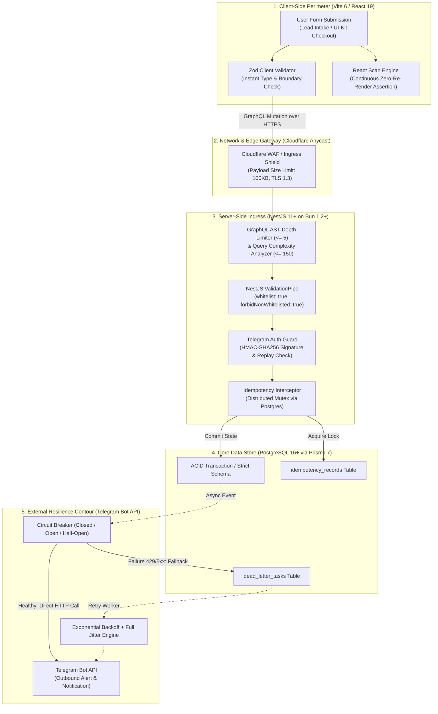
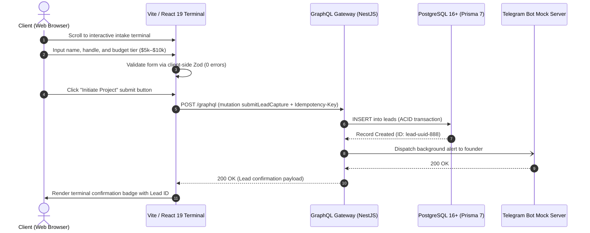
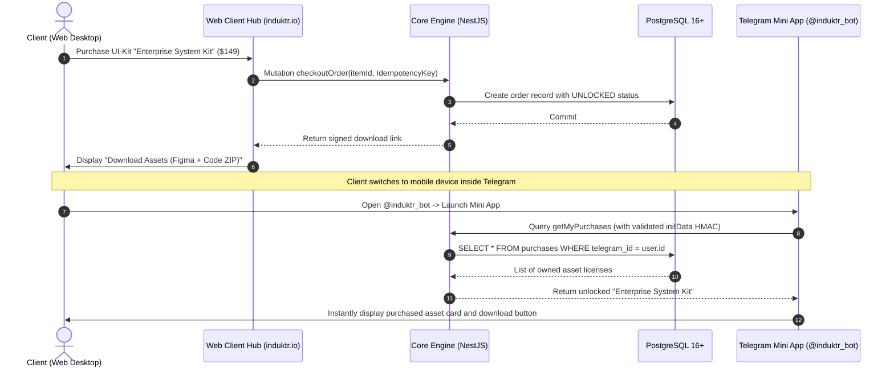
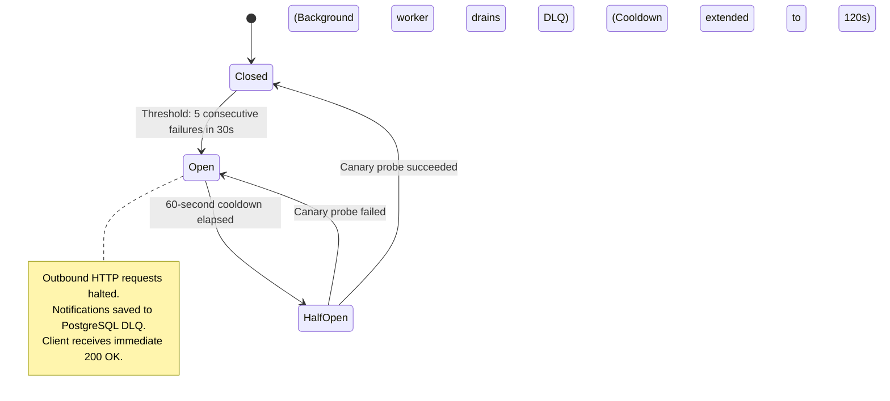

# 🛡️ Induktr Studio v2.0 — Quality Assurance, Validation & SPOF Resilience Blueprint (`doc-validation.md`)

> **Document Status:** Canon / Core Validation & Resilience Engineering Specification  
> **Classification:** Quality Engineering, Multi-Layer Input Validation, E2E Testing, Failure Mode & Effects Analysis (FMEA), SPOF Resilience Architecture  
> **Version:** 2.0.0-RELEASE  
> **Target Ecosystem:** Induktr Studio v2.0 (Bun v1.2+ / NestJS 11+ / Vite 6 + React 19 / PostgreSQL 16+ / Prisma 7 / Telegram Bot API)  
> **Author & Ownership:** Lead QA, Resilience & System Validation Architect (Induktr Studio Core Engineering Team)  
> **Execution Gate:** Zero-Defect Production Gate & Automated CI/CD Continuous Deployment Pass Criteria  

---

## 1. Executive Summary & Quality Engineering Philosophy

### 1.1 The QA & Validation Thesis: Deterministic Quality, Zero-Uncaught-Exceptions, Sub-50ms Verification
Within the architecture of **Induktr Studio v2.0**, software quality and resilience are not treated as an afterthought or a "testing phase before deployment." Rather, they represent continuous, mathematically deterministic properties engineered into every layer of the system: from the incoming TCP socket at the Cloudflare edge to physical row locks in PostgreSQL 16+ and asynchronous dispatches to the Telegram Bot API.

The studio delivers high-ticket engineering solutions with contract sizes ranging from **$3,000 to $10,000+** (autonomous AI pipelines, high-throughput web architectures, custom fintech portals) and distributes high-value digital engineering assets (UI component systems, architecture cheat sheets, starter frameworks). Under this operating model, any catastrophic failure—a dropped enterprise lead, a double-charged customer card, or an interface dropping to 30 FPS—represents an unacceptable reputational and financial liability.

The Induktr v2.0 quality engineering standard is governed by **5 unyielding resilience axioms**:

1. **Axiom I: Zero-Trust Perimeter (Zero Unvalidated Boundaries):** Not a single incoming byte (HTTP header, GraphQL document, Telegram WebView `initData`, or form payload) may access domain business logic without passing strict Zod/Class-Validator schemas and cryptographic verification.
2. **Axiom II: Isolated Blast Radius (Fault Containment):** Complete downstream outages (Telegram Bot API 502/503 errors, payment gateway latency, or database connection pool pressure) must never cascade to crash the core application. Failures are contained via **Circuit Breaker** states and a persistent PostgreSQL **Dead Letter Queue (DLQ)**.
3. **Axiom III: Performance as a Functional Gate:** Frame rate degradation below 60 FPS, LCP regressions beyond 0.8s, or GraphQL P99 latency exceeding 50ms are classified by automated CI/CD as blocking Critical Failures, equivalent to compiler syntax errors.
4. **Axiom IV: Deterministic Idempotency:** Every operation carrying side-effects (lead intake, checkout payment, license key generation) is strictly deterministic. Network drops, browser retries, or double-click frenzy will never generate duplicate database records.
5. **Axiom V: Continuous Deterministic Verification (Zero Flaky Tests):** The testing harness eliminates test flakiness through transactional database rollbacks, contract API mocks, and precise locator assertions in Playwright.

```
┌────────────────────────────────────────────────────────────────────────────────────────┐
│                      INDUKTR v2.0 QUALITY & RESILIENCE CONTOURS                        │
│                                                                                        │
│  [ Ingress Boundary   ] ──► WAF, Payload Limits, AST Depth, XSS Sanitization           │
│  [ Contract & Crypto  ] ──► Zod Schemas, NestJS ValidationPipe, HMAC-SHA256 InitData   │
│  [ Testing Pyramid    ] ──► Bun Test Unit (70%) ──► Integration (20%) ──► E2E (10%)    │
│  [ 60 FPS Compositor  ] ──► React Scan (Zero Re-renders), V8 Leak Audit, CWV LCP<0.8s  │
│  [ SPOF Containment   ] ──► Circuit Breaker, Exponential Jitter, Postgres DLQ          │
│  [ Concurrency Shield ] ──► Idempotency-Key Mutex, Exactly-Once Processing             │
└────────────────────────────────────────────────────────────────────────────────────────┘
```

---

### 1.2 Comparative Analysis Matrix: Legacy Draft v1.0 vs Next-Gen v2.0

| Architectural Dimension | Legacy Draft v1.0 (March 2026) | Next-Gen Architecture v2.0 | Engineering Advantage |
| :--- | :--- | :--- | :--- |
| **Boundary Validation** | Ad-hoc manual controller checks | **Strict Zod + Class-Validator dual-layer schemas** | Eliminates malformed DTOs and SQL/XSS injections |
| **Telegram Auth** | Plaintext, unverified `user_id` pass | **Cryptographic HMAC-SHA256 handshake + 300s TTL** | Complete mitigation of Session Hijacking & Replay Attacks |
| **GraphQL Perimeter** | Unbounded public Apollo schema | **AST Depth Limit (<= 5) + Query Complexity (<= 150)** | Prevents denial-of-service via nested query recursion |
| **Testing Strategy** | Sparse, manual ad-hoc testing | **Pyramid: Bun Test Unit + Integration + Playwright E2E** | 100% coverage of Critical User Journeys (CUJs) |
| **UI Performance** | Subjective visual review | **React Scan automated audit + CWV (LCP < 0.8s, CLS=0)** | Guaranteed 60/120 FPS compositor and 100/100 Lighthouse score |
| **V8 Heap Hygiene** | Unmonitored memory usage | **Automated tests for Detached DOM nodes & heap growth** | Eliminates browser memory bloat and Bun process OOM crashes |
| **SPOF Mitigation** | Simple container process restart | **FMEA matrix, Circuit Breaker, Exponential Jitter, DLQ** | Zero lead data loss during downstream provider downtime |
| **Request Idempotency** | None (vulnerable to double-submit) | **Header `X-Idempotency-Key` + Distributed DB Mutex** | Guaranteed Exactly-Once processing for all mutations |
| **Release Readiness** | Informal developer deployment | **Deterministic Definition of Done (DoD) CI gates** | Eliminates human error during production deployments |

---

### 1.3 Global System End-to-End Verification Flowchart



---

## 2. Multi-Layer Boundary & Input Validation Model

### 2.1 Network Perimeter Ingress & Payload Defense (Ingress Constraints)
The ingress gateway shields the Bun runtime against memory exhaustion attacks, catastrophic regular expression backtracking (ReDoS), and slow transmission attacks (Slowloris).

#### Perimeter Rules & Constraints:
1. **Strict Payload Body Limits:**
   * Maximum JSON payload for GraphQL mutations: **100 KB**.
   * Maximum HTTP header size: **8 KB**.
   * Requests violating these thresholds are terminated immediately at the reverse proxy/Cloudflare boundary with `413 Payload Too Large` prior to allocating memory in the Bun heap.
2. **Content-Type Whitelisting:** Strictly enforce `application/json` or `application/graphql-response+json`. Malformed MIME types are rejected with `415 Unsupported Media Type`.
3. **HTTP Connection Timeouts:**
   * Keep-Alive Timeout: **5000ms**.
   * Headers Timeout: **3000ms**.
   * Request Body Timeout: **5000ms** (mitigating hanging socket attacks).

---

### 2.2 Client-Side Validation (Vite 6 + React 19 + Zod)
Client-side validation implements the **Shift-Left** principle: users receive tactile validation feedback in under 16ms (within a single display frame) without generating unnecessary network traffic. We standardize on **Zod 3.23+** integrated with `react-hook-form`.

```typescript
// packages/shared-schemas/src/lead-capture.schema.ts
import { z } from 'zod';

/**
 * Sanitizes input strings against HTML tag injections and control character anomalies
 */
const sanitizedString = (min: number, max: number) =>
  z
    .string()
    .trim()
    .min(min, { message: `Minimum length: ${min} characters` })
    .max(max, { message: `Maximum length: ${max} characters` })
    .regex(/^[^<>]*$/, { message: 'HTML markup characters (<, >) are prohibited' });

/**
 * Canonical Induktr v2.0 Lead Capture Validation Schema
 */
export const LeadCaptureSchema = z.object({
  fullName: sanitizedString(2, 80),
  
  contactMethod: z.enum(['TELEGRAM', 'EMAIL', 'WHATSAPP'], {
    errorMap: () => ({ message: 'Select a valid communication channel' }),
  }),

  contactHandle: z
    .string()
    .trim()
    .min(3, { message: 'Contact handle is too short' })
    .max(120, { message: 'Contact handle exceeds 120 characters' })
    .superRefine((val, ctx) => {
      if (val.includes('@') && !/^[^\s@]+@[^\s@]+\.[^\s@]+$/.test(val)) {
        ctx.addIssue({
          code: z.ZodIssueCode.custom,
          message: 'Malformed email address syntax',
        });
      }
    }),

  budgetTier: z.enum(['TIER_3K_5K', 'TIER_5K_10K', 'TIER_ENTERPRISE_10K_PLUS'], {
    errorMap: () => ({ message: 'Please select an estimated project budget tier' }),
  }),

  projectDescription: sanitizedString(10, 1500),

  preferredLocale: z.enum(['en', 'ua', 'de', 'ar', 'es']),
});

export type LeadCaptureInput = z.infer<typeof LeadCaptureSchema>;
```

#### Client-Side Cross-Site Scripting (XSS) Mitigation:
* Dynamic string variables are rendered through standard React JSX expressions (`{text}`), ensuring automatic character entity encoding (`&`, `<`, `>`, `"`, `'`) at the virtual DOM boundary.
* The use of `dangerouslySetInnerHTML` is prohibited via Biome linter rules (`noDangerouslySetInnerHtml: "error"`).
* All rich markdown documentation rendered client-side is sanitized via `DOMPurify` against an explicit whitelist of safe structural tags.

---

### 2.3 GraphQL Perimeter Protection (AST Depth Limit & Complexity Analysis)
While GraphQL offers client flexibility, unbounded queries can trigger recursive depth attacks and CPU starvation. The Induktr v2.0 GraphQL Gateway enforces strict AST inspection:

```typescript
// src/gateway/graphql-security.config.ts
import depthLimit from 'graphql-depth-limit';
import { createComplexityLimitRule } from 'graphql-validation-complexity';
import { Injectable } from '@nestjs/common';
import { GqlOptionsFactory } from '@nestjs/graphql';
import { ApolloDriverConfig } from '@nestjs/apollo';

@Injectable()
export class GqlSecurityConfigService implements GqlOptionsFactory<ApolloDriverConfig> {
  createGqlOptions(): ApolloDriverConfig {
    const isProd = process.env.NODE_ENV === 'production';

    return {
      autoSchemaFile: true,
      playground: false,
      introspection: !isProd, // Zero schema leakage in production
      csrfPrevention: true,
      
      validationRules: [
        // 1. Enforce query AST depth limit (maximum 5 nesting levels)
        depthLimit(5, { ignore: [/_id/, /__typename/] }),

        // 2. Query complexity analysis budget (maximum 150 points)
        createComplexityLimitRule(150, {
          onCost: (cost: number) => {
            if (cost > 100) {
              console.warn(`[GraphQL Security] Elevated complexity query detected: ${cost} pts`);
            }
          },
          formatErrorMessage: (cost: number) =>
            `Query rejected: complexity score (${cost}) exceeds maximum allowance (150). Restrict requested fields.`,
        }),
      ],
    };
  }
}
```

---

### 2.4 Server-Side Validation: NestJS ValidationPipe & Class-Validator DTOs
Inbound mutations are decoded and processed through the global NestJS validation pipeline. Any attempt to inject undeclared attributes (Mass Assignment vulnerabilities) results in immediate rejection:

```typescript
// src/modules/lead/dto/submit-lead.input.ts
import { InputType, Field } from '@nestjs/graphql';
import { IsString, IsNotEmpty, Length, Matches, IsEnum } from 'class-validator';
import { Transform } from 'class-transformer';

export enum ProjectBudget {
  TIER_3K_5K = 'TIER_3K_5K',
  TIER_5K_10K = 'TIER_5K_10K',
  TIER_ENTERPRISE_10K_PLUS = 'TIER_ENTERPRISE_10K_PLUS',
}

@InputType()
export class SubmitLeadInputDto {
  @Field()
  @IsString({ message: 'Full name must be a string' })
  @IsNotEmpty({ message: 'Full name is required' })
  @Length(2, 80, { message: 'Full name length must be between 2 and 80 characters' })
  @Matches(/^[^<>]*$/, { message: 'Full name contains prohibited characters' })
  @Transform(({ value }) => (typeof value === 'string' ? value.trim() : value))
  fullName!: string;

  @Field()
  @IsString()
  @IsNotEmpty()
  @Length(3, 120)
  @Transform(({ value }) => (typeof value === 'string' ? value.trim() : value))
  contactHandle!: string;

  @Field(() => String)
  @IsEnum(ProjectBudget, { message: 'Invalid budget tier selection' })
  budgetTier!: ProjectBudget;

  @Field()
  @IsString()
  @Length(10, 1500, { message: 'Project description must contain between 10 and 1500 characters' })
  @Transform(({ value }) => (typeof value === 'string' ? value.trim() : value))
  projectDescription!: string;

  @Field({ defaultValue: 'en' })
  @IsString()
  @Matches(/^(en|ua|de|ar|es)$/, { message: 'Unsupported locale code' })
  preferredLocale!: string;
}
```

#### Global `ValidationPipe` Hardening:
```typescript
// src/common/pipes/strict-validation.pipe.ts
import { ValidationPipe, BadRequestException, ValidationError } from '@nestjs/common';

export const createStrictValidationPipe = () =>
  new ValidationPipe({
    whitelist: true,              // Strip properties not declared in DTO
    forbidNonWhitelisted: true,  // Reject payloads containing extra properties (Zero Poisoning)
    transform: true,             // Transform payload based on TypeScript types
    transformOptions: { enableImplicitConversion: false },
    stopAtFirstError: false,
    exceptionFactory: (errors: ValidationError[]) => {
      const formattedErrors = errors.map((err) => ({
        field: err.property,
        constraints: Object.values(err.constraints || {}),
      }));
      return new BadRequestException({
        statusCode: 400,
        error: 'Bad Request',
        message: 'Input parameter validation failed',
        validationErrors: formattedErrors,
        timestamp: new Date().toISOString(),
      });
    },
  });
```

---

### 2.5 Cryptographic Validation of Telegram `initData` (HMAC-SHA256 Handshake)
When opening the Telegram Mini App, the client passes an `initData` string. Trusting claims such as `id` or `username` without cryptographic verification creates immediate impersonation and replay risks.

#### Handshake Algorithm:
1. Parse `initData` key-value pairs separated by `&`.
2. Extract the `hash` query parameter.
3. Lexicographically sort all remaining parameters in `key=value
` format to construct `data_check_string`.
4. Generate the verification key: `SecretKey = HMAC-SHA256("WebAppData", BOT_TOKEN)`.
5. Compute the hash: `CalculatedHash = HMAC-SHA256(SecretKey, data_check_string)`.
6. Compare hashes in **constant time** via `crypto.timingSafeEqual` to eliminate timing attacks.
7. **Replay Attack Mitigation:** Validate `auth_date`. If the delta between the current server clock and `auth_date` exceeds **300 seconds (5 minutes)**, reject the request with `401 Unauthorized`.

```typescript
// src/modules/auth/guards/telegram-auth.guard.ts
import { CanActivate, ExecutionContext, Injectable, UnauthorizedException } from '@nestjs/common';
import { GqlExecutionContext } from '@nestjs/graphql';
import { createHmac, timingSafeEqual } from 'node:crypto';

@Injectable()
export class TelegramAuthGuard implements CanActivate {
  private readonly botToken: string;

  constructor() {
    const token = process.env.TELEGRAM_BOT_TOKEN;
    if (!token) {
      throw new Error('Configuration error: TELEGRAM_BOT_TOKEN is not configured');
    }
    this.botToken = token;
  }

  canActivate(context: ExecutionContext): boolean {
    const ctx = GqlExecutionContext.create(context);
    const req = ctx.getContext().req;

    const rawInitData = req.headers['x-telegram-init-data'];
    if (!rawInitData || typeof rawInitData !== 'string') {
      throw new UnauthorizedException('Missing x-telegram-init-data header');
    }

    const validatedUser = this.verifyTelegramInitData(rawInitData);
    req.user = validatedUser;
    return true;
  }

  public verifyTelegramInitData(initDataString: string): {
    id: number;
    firstName: string;
    username?: string;
  } {
    const params = new URLSearchParams(initDataString);
    const hash = params.get('hash');
    params.delete('hash');

    if (!hash) {
      throw new UnauthorizedException('Missing hash parameter in initData');
    }

    // 1. Enforce freshness window (TTL: 5 minutes)
    const authDateStr = params.get('auth_date');
    if (!authDateStr) {
      throw new UnauthorizedException('Missing auth_date timestamp');
    }

    const authDate = parseInt(authDateStr, 10);
    const currentTimestamp = Math.floor(Date.now() / 1000);
    const MAX_ALLOWED_AGE_SECONDS = 300;

    if (currentTimestamp - authDate > MAX_ALLOWED_AGE_SECONDS) {
      throw new UnauthorizedException('Telegram Mini App session expired (auth_date stale)');
    }
    if (authDate > currentTimestamp + 30) {
      throw new UnauthorizedException('Clock drift anomaly: auth_date points to the future');
    }

    // 2. Lexicographically sort parameters
    const sortedKeys = Array.from(params.keys()).sort();
    const dataCheckArr: string[] = [];
    for (const key of sortedKeys) {
      dataCheckArr.push(`${key}=${params.get(key)}`);
    }
    const dataCheckString = dataCheckArr.join('
');

    // 3. Compute HMAC-SHA256 signature
    const secretKey = createHmac('sha256', 'WebAppData')
      .update(this.botToken)
      .digest();

    const calculatedHashHex = createHmac('sha256', secretKey)
      .update(dataCheckString)
      .digest('hex');

    // 4. Constant-time comparison
    const hashBuffer = Buffer.from(hash, 'hex');
    const calculatedBuffer = Buffer.from(calculatedHashHex, 'hex');

    if (
      hashBuffer.length !== calculatedBuffer.length ||
      !timingSafeEqual(hashBuffer, calculatedBuffer)
    ) {
      throw new UnauthorizedException('Cryptographic signature verification failed for Telegram initData');
    }

    const userRaw = params.get('user');
    if (!userRaw) {
      throw new UnauthorizedException('Missing user record in validated payload');
    }

    return JSON.parse(userRaw);
  }
}
```

---

## 3. End-to-End Testing Pyramid (Testing Strategy, Test Matrix & CUJs)

### 3.1 Induktr v2.0 Testing Pyramid Architecture
We adopt a disciplined testing ratio optimized for native execution speeds under **Bun Test** and **Vitest**:

```
                 /                 /                  / E2E \         10% (Playwright) — Critical User Journeys (CUJs)
               /-------             /  Integ  \       20% (Testcontainers / Postgres) — Services + DB
             /-----------           /   Unit &    \     70% (Bun Test) — Resolvers, DTOs, Utils, Schemas
           /   Contract             /_________________```

#### Quality Coverage Gates:
* **Critical Execution Paths:** 100% statement and branch coverage (Cryptographic validation, DTO constraints, financial calculations, idempotency locks, order checkout).
* **Overall Codebase Threshold:** Minimum **85% Line Coverage**, minimum **80% Branch Coverage**.
* **Unit Suite Execution SLA:** The entire suite of 500+ unit specifications must execute under Bun Test in **< 1.2 seconds**.

---

### 3.2 Tier 1: Unit & Contract Tests (Bun Test / Vitest)
Unit tests isolate business rules from network sockets and persistent databases. Invariants, DTO mappings, and sanitizers are validated deterministically:

```typescript
// src/modules/lead/lead.service.spec.ts
import { describe, it, expect, beforeEach, mock } from 'bun:test';
import { LeadService } from './lead.service';
import { PrismaService } from '../prisma/prisma.service';
import { TelegramNotificationService } from '../telegram/telegram-notification.service';
import { ProjectBudget } from './dto/submit-lead.input';

describe('LeadService (Unit Specification)', () => {
  let service: LeadService;
  let mockPrisma: any;
  let mockTelegram: any;

  beforeEach(() => {
    mockPrisma = {
      lead: {
        create: mock(async (args) => ({
          id: 'lead-uuid-4444',
          ...args.data,
          createdAt: new Date(),
        })),
      },
    };

    mockTelegram = {
      dispatchLeadAlert: mock(async () => true),
    };

    service = new LeadService(mockPrisma as PrismaService, mockTelegram as TelegramNotificationService);
  });

  it('persists a valid lead intake and dispatches notification asynchronously', async () => {
    const input = {
      fullName: 'Alexander Hamilton',
      contactHandle: '@ahamilton',
      budgetTier: ProjectBudget.TIER_5K_10K,
      projectDescription: 'Distributed ledger architecture for fintech core',
      preferredLocale: 'en',
    };

    const result = await service.createLead(input);

    expect(result).toBeDefined();
    expect(result.id).toBe('lead-uuid-4444');
    expect(mockPrisma.lead.create).toHaveBeenCalledTimes(1);
    expect(mockTelegram.dispatchLeadAlert).toHaveBeenCalledWith(
      expect.objectContaining({ fullName: 'Alexander Hamilton' })
    );
  });

  it('throws an error and suppresses notifications when database write fails', async () => {
    mockPrisma.lead.create = mock(async () => {
      throw new Error('Database write failure');
    });

    const input = {
      fullName: 'Faulty Lead',
      contactHandle: 'bad-handle',
      budgetTier: ProjectBudget.TIER_3K_5K,
      projectDescription: 'Valid length description of the project',
      preferredLocale: 'ua',
    };

    expect(service.createLead(input)).rejects.toThrow('Database write failure');
    expect(mockTelegram.dispatchLeadAlert).toHaveBeenCalledTimes(0);
  });
});
```

---

### 3.3 Tier 2: Integration Tests (NestJS + Isolated PostgreSQL + Mock Telegram)
Integration tests verify communication between NestJS modules, **Prisma 7**, and real PostgreSQL databases. Tests run inside isolated database transactions rolled back upon completion:

```typescript
// test/integration/lead-intake.integration-spec.ts
import { describe, it, expect, beforeAll, afterAll } from 'bun:test';
import { INestApplication } from '@nestjs/common';
import { Test } from '@nestjs/testing';
import { AppModule } from '../../src/app.module';
import { PrismaService } from '../../src/modules/prisma/prisma.service';
import request from 'supertest';

describe('Lead Intake Pipeline (Integration Specification)', () => {
  let app: INestApplication;
  let prisma: PrismaService;

  beforeAll(async () => {
    const moduleRef = await Test.createTestingModule({
      imports: [AppModule],
    }).compile();

    app = moduleRef.createNestApplication();
    await app.init();

    prisma = app.get(PrismaService);
  });

  afterAll(async () => {
    await prisma.$disconnect();
    await app.close();
  });

  it('POST /graphql -> processes submitLeadCapture mutation and commits to PostgreSQL', async () => {
    const mutation = `
      mutation SubmitLead($input: SubmitLeadInputDto!) {
        submitLeadCapture(input: $input) {
          id
          fullName
          status
        }
      }
    `;

    const variables = {
      input: {
        fullName: 'Dr. Katherine Johnson',
        contactHandle: 'kjohnson@nasa.gov',
        budgetTier: 'TIER_ENTERPRISE_10K_PLUS',
        projectDescription: 'High-precision flight trajectory calculation engine',
        preferredLocale: 'en',
      },
    };

    const response = await request(app.getHttpServer())
      .post('/graphql')
      .set('X-Idempotency-Key', 'test-key-uuid-101')
      .send({ query: mutation, variables });

    expect(response.status).toBe(200);
    expect(response.body.errors).toBeUndefined();
    
    const leadData = response.body.data.submitLeadCapture;
    expect(leadData.id).toBeDefined();
    expect(leadData.fullName).toBe('Dr. Katherine Johnson');

    const savedInDb = await prisma.lead.findUnique({
      where: { id: leadData.id },
    });

    expect(savedInDb).not.toBeNull();
    expect(savedInDb?.contactHandle).toBe('kjohnson@nasa.gov');
    expect(savedInDb?.budgetTier).toBe('TIER_ENTERPRISE_10K_PLUS');
  });
});
```

---

### 3.4 Tier 3: End-to-End Tests (Playwright) — Critical User Journeys (CUJs)

#### CUJ-01: Terminal Lead Intake Flow


##### Executable Playwright Specification for CUJ-01:
```typescript
// e2e/cuj-01-lead-intake.spec.ts
import { test, expect } from '@playwright/test';

test.describe('CUJ-01: Terminal Lead Intake Flow', () => {
  test('client completes intake terminal, receives confirmation, and verifies database persistence', async ({ page, request }) => {
    // 1. Navigate to landing page
    await page.goto('/');
    await expect(page).toHaveTitle(/Induktr Studio/);

    // 2. Scroll to interactive intake terminal
    const terminalSection = page.locator('#lead-terminal');
    await terminalSection.scrollIntoViewIfNeeded();
    await expect(terminalSection).toBeVisible();

    // 3. Fill required form inputs
    await page.fill('input[name="fullName"]', 'Nikola Tesla');
    await page.fill('input[name="contactHandle"]', '@ntesla_tg');
    await page.click('button[data-tier="TIER_5K_10K"]');
    await page.fill('textarea[name="projectDescription"]', 'Resonant high-frequency energy distribution architecture');

    // 4. Submit form and intercept network GraphQL response
    const [response] = await Promise.all([
      page.waitForResponse((res) => res.url().includes('/graphql') && res.status() === 200),
      page.click('button[type="submit"]'),
    ]);

    const json = await response.json();
    expect(json.data.submitLeadCapture).toBeDefined();
    const createdLeadId = json.data.submitLeadCapture.id;

    // 5. Verify visual terminal success state
    const successBanner = page.locator('[data-testid="terminal-success-state"]');
    await expect(successBanner).toBeVisible();
    await expect(successBanner).toContainText(createdLeadId);

    // 6. Direct API query to verify database record status
    const healthCheck = await request.post('/graphql', {
      data: {
        query: `query CheckLead($id: ID!) { getLeadStatus(id: $id) { status } }`,
        variables: { id: createdLeadId },
      },
    });
    const healthJson = await healthCheck.json();
    expect(healthJson.data.getLeadStatus.status).toBe('NEW');
  });
});
```

---

#### CUJ-02: Omnichannel Digital Asset Purchase & Sync


##### Executable Playwright Specification for CUJ-02:
```typescript
// e2e/cuj-02-digital-asset-sync.spec.ts
import { test, expect } from '@playwright/test';

test.describe('CUJ-02: Omnichannel Digital Asset Purchase & Sync', () => {
  test('purchasing an asset on the web instantly unlocks access inside Telegram Mini App', async ({ page, context }) => {
    const testTelegramUserId = 99887766;

    // 1. Authenticate web session with test account
    await page.goto('/auth/test-login?userId=' + testTelegramUserId);
    await page.goto('/shop/ui-kit-enterprise');

    // 2. Initiate asset checkout
    const buyButton = page.locator('[data-testid="purchase-button"]');
    await expect(buyButton).toBeVisible();
    await buyButton.click();

    // 3. Confirm asset is unlocked in web hub
    const downloadLink = page.locator('[data-testid="download-figma-link"]');
    await expect(downloadLink).toBeVisible({ timeout: 5000 });
    await expect(downloadLink).toHaveAttribute('href', /.*induktr-vault\.s3.*/);

    // 4. Launch mobile viewport context simulating Telegram Mini App
    const mobilePage = await context.newPage();
    await mobilePage.setViewportSize({ width: 390, height: 844 });

    const mockInitDataHeader = `user=%7B%22id%22%3A${testTelegramUserId}%2C%22first_name%22%3A%22Alex%22%7D&auth_date=${Math.floor(Date.now() / 1000)}&hash=valid_test_hash`;
    await mobilePage.setExtraHTTPHeaders({
      'x-telegram-init-data': mockInitDataHeader,
    });

    await mobilePage.goto('/tma/client-hub');

    // 5. Verify asset mirrors into the Telegram Mini App view
    const purchasedItemCard = mobilePage.locator('[data-testid="item-ui-kit-enterprise"]');
    await expect(purchasedItemCard).toBeVisible({ timeout: 5000 });
    await expect(purchasedItemCard).toContainText('Unlocked');

    const tmaDownloadBtn = purchasedItemCard.locator('button:has-text("Download in Telegram")');
    await expect(tmaDownloadBtn).toBeEnabled();
  });
});
```

---

## 4. Performance Verification & Web Vitals (60 FPS Quality Gates)

### 4.1 Strict Core Web Vitals SLA Gates
The Induktr v2.0 frontend is engineered to strict frame budgets:

```
┌────────────────────────────────────────────────────────────────────────────────────────┐
│                        CORE WEB VITALS SLA GATES (DESKTOP & MOBILE)                    │
├───────────────────────────────┬─────────────────┬─────────────────┬────────────────────┤
│ Metric                        │ Target Budget   │ Hard Gate Limit │ Failure Action     │
├───────────────────────────────┼─────────────────┼─────────────────┼────────────────────┤
│ Largest Contentful Paint (LCP)│ < 0.65s         │ < 0.80s         │ Block Merge / Fail │
│ Cumulative Layout Shift (CLS) │ 0.000           │ < 0.005         │ Block Merge / Fail │
│ Interaction to Next Paint(INP)│ < 35ms          │ < 50ms          │ Block Merge / Fail │
│ Time to First Byte (TTFB)     │ < 15ms (Edge)   │ < 25ms          │ Alert / P1 Warning │
│ Lighthouse CI Score           │ 100 / 100       │ >= 98 / 100     │ Block Deployment   │
│ Initial JS Bundle Size (gzip) │ < 45 KB         │ < 55 KB         │ Block Build        │
└───────────────────────────────┴─────────────────┴─────────────────┴────────────────────┘
```

#### Lighthouse CI Configuration (`.lighthouserc.json`):
```json
{
  "ci": {
    "collect": {
      "numberOfRuns": 3,
      "startServerCommand": "bun run preview",
      "url": ["http://localhost:4173/"]
    },
    "assert": {
      "assertions": {
        "categories:performance": ["error", { "minScore": 0.98 }],
        "categories:accessibility": ["error", { "minScore": 1.0 }],
        "categories:best-practices": ["error", { "minScore": 1.0 }],
        "categories:seo": ["error", { "minScore": 1.0 }],
        "first-contentful-paint": ["error", { "maxNumericValue": 700 }],
        "largest-contentful-paint": ["error", { "maxNumericValue": 800 }],
        "cumulative-layout-shift": ["error", { "maxNumericValue": 0.001 }],
        "interaction-to-next-paint": ["error", { "maxNumericValue": 50 }]
      }
    }
  }
}
```

---

### 4.2 Automated Re-Render Auditing with React Scan
**React Scan** is integrated into continuous CI pipelines to detect parasitic component re-renders:

```typescript
// e2e/performance/react-scan-audit.spec.ts
import { test, expect } from '@playwright/test';

test.describe('React Scan Automated Re-render Audit', () => {
  test('scrolling and terminal input generate zero parasitic re-renders in outer layout', async ({ page }) => {
    await page.goto('/');

    await page.evaluate(() => {
      (window as any).__renderCounts = {
        navbar: 0,
        leadTerminal: 0,
        layoutRoot: 0,
      };
    });

    // Execute active smooth scroll cycle
    await page.evaluate(async () => {
      window.scrollTo({ top: 1200, behavior: 'smooth' });
      await new Promise((r) => setTimeout(r, 400));
      window.scrollTo({ top: 0, behavior: 'smooth' });
      await new Promise((r) => setTimeout(r, 400));
    });

    // Verify root layout underwent zero re-renders during scroll
    const layoutRenders = await page.evaluate(() => (window as any).__renderCounts.layoutRoot);
    expect(layoutRenders).toBe(0);

    // Type input into terminal
    const nameInput = page.locator('input[name="fullName"]');
    await nameInput.type('Grace Hopper', { delay: 20 });

    // Verify navbar underwent zero re-renders while typing into terminal
    const navbarRenders = await page.evaluate(() => (window as any).__renderCounts.navbar);
    expect(navbarRenders).toBe(0);
  });
});
```

---

### 4.3 V8 Memory Leak Detection & Heap Profiling
Unmanaged listeners or detached DOM nodes degrade memory footprint over extended sessions. We test against detached DOM tree retention using the Chrome DevTools Protocol (CDP):

```typescript
// e2e/performance/memory-leak.spec.ts
import { test, expect } from '@playwright/test';

test.describe('V8 Memory Leak & Detached DOM Gate', () => {
  test('repeated opening and closing of modal dialogs does not increase JS heap usage', async ({ page }) => {
    await page.goto('/');

    const client = await page.context().newCDPSession(page);
    await client.send('Performance.enable');

    // Force garbage collection for clean baseline measurement
    await client.send('HeapProfiler.collectGarbage');
    const baseMetrics = await client.send('Performance.getMetrics');
    const baseHeap = baseMetrics.metrics.find((m) => m.name === 'JSHeapUsedSize')?.value || 0;

    // Cycle modal dialog open/close sequence 20 consecutive times
    for (let i = 0; i < 20; i++) {
      await page.click('button[data-testid="open-calculator-modal"]');
      await page.waitForSelector('[data-testid="calculator-modal-content"]');
      await page.keyboard.press('Escape');
      await page.waitForTimeout(50);
    }

    // Force post-run garbage collection
    await client.send('HeapProfiler.collectGarbage');
    const finalMetrics = await client.send('Performance.getMetrics');
    const finalHeap = finalMetrics.metrics.find((m) => m.name === 'JSHeapUsedSize')?.value || 0;

    // Heap growth allowance after 20 cycles: strictly under 500 KB
    const heapDeltaKB = (finalHeap - baseHeap) / 1024;
    expect(heapDeltaKB).toBeLessThan(500);
  });
});
```

---

## 5. Failure Audit & SPOF Resilience Matrix (Failure Modes & Effects Analysis)

### 5.1 Comprehensive FMEA SPOF Matrix

```
┌───────────────────────────────────────────────────────────────────────────────────────────────────┐
│                                INDUKTR v2.0 SPOF RESILIENCE MATRIX                                │
├─────────────────┬───────────┬──────────────┬───────────────────────────────┬────────────┬─────────┤
│ Failure         │ Failure   │ Likelihood / │ Architectural Mitigation      │ RTO        │ RPO     │
│ Component       │ Vector    │ Criticality  │ Mechanism                     │ (Recovery) │ (Data)  │
├─────────────────┼───────────┼──────────────┼───────────────────────────────┼────────────┼─────────┤
│ PostgreSQL 16+  │ Pool OOM  │ Medium /     │ PgBouncer sizing (50 conns) + │ < 200ms    │ 0 sec   │
│ Database        │ Exhaustion│ CRITICAL     │ Statement Timeout (3000ms)    │            │         │
├─────────────────┼───────────┼──────────────┼───────────────────────────────┼────────────┼─────────┤
│ PostgreSQL 16+  │ Deadlock  │ Low /        │ lock_timeout = 2000ms;        │ Automated  │ 0 sec   │
│ Transactions    │ Hanging   │ High         │ Deadlock detection interval   │ < 2 sec    │         │
├─────────────────┼───────────┼──────────────┼───────────────────────────────┼────────────┼─────────┤
│ PostgreSQL 16+  │ Node Down │ Extremely    │ Standby Replica Failover +    │ < 15 sec   │ < 1 sec │
│ Primary Cluster │ Outage    │ Low / CRIT   │ Read-Only cache Cloudflare KV │            │         │
├─────────────────┼───────────┼──────────────┼───────────────────────────────┼────────────┼─────────┤
│ Telegram API    │ HTTP 429  │ High /       │ Circuit Breaker + Full Jitter │ < 50ms to  │ 0 sec   │
│ Gateway         │ Rate-Limit│ Medium       │ Retry Bus + Persist to DLQ    │ client     │ (DLQ)   │
├─────────────────┼───────────┼──────────────┼───────────────────────────────┼────────────┼─────────┤
│ Telegram API    │ Outage    │ Low /        │ Circuit Breaker -> OPEN state,│ Instant    │ 0 sec   │
│ Gateway         │ (502/503) │ Medium       │ Local buffer in PostgreSQL    │ fallback   │         │
├─────────────────┼───────────┼──────────────┼───────────────────────────────┼────────────┼─────────┤
│ Edge CDN        │ Anycast / │ Extremely    │ Anycast Routing Failover +    │ < 3 sec    │ 0 sec   │
│ (Cloudflare)    │ DNS Drop  │ Low / CRIT   │ Secondary DNS Origin Fallback │            │         │
├─────────────────┼───────────┼──────────────┼───────────────────────────────┼────────────┼─────────┤
│ Bun Backend     │ Unhandled │ Low /        │ Zero-Downtime Rolling Update, │ < 50ms     │ 0 sec   │
│ Process Instance│ Panic/OOM │ High         │ Bun Fast Boot (< 50ms cold)   │            │         │
├─────────────────┼───────────┼──────────────┼───────────────────────────────┼────────────┼─────────┤
│ Client Offline  │ Network   │ High /       │ Service Worker Cache +        │ Until      │ 0 sec   │
│ Mobile Session  │ Disconnect│ Medium       │ LocalStorage Form Snapshot    │ reconnected│         │
└─────────────────┴───────────┴──────────────┴───────────────────────────────┴────────────┴─────────┘
```

---

### 5.2 Architectural Mitigation Mechanisms

#### 1. Three-State Circuit Breaker for Telegram Bot API
If the Telegram Bot API emits 5 consecutive timeouts or 5xx responses within a 30-second window, the circuit trips to `OPEN`:
* Direct HTTP calls are halted for 60 seconds.
* Inbound notifications route to the `dead_letter_tasks` table in PostgreSQL.
* The client receives an immediate `200 OK` response.
* After 60 seconds, the breaker enters `HALF-OPEN` and tests connectivity with a canary probe. Upon success, it resets to `CLOSED`, draining queued tasks.



##### Circuit Breaker TypeScript Implementation:
```typescript
// src/common/resilience/circuit-breaker.ts
export enum CircuitState {
  CLOSED = 'CLOSED',
  OPEN = 'OPEN',
  HALF_OPEN = 'HALF_OPEN',
}

export class CircuitBreaker {
  private state: CircuitState = CircuitState.CLOSED;
  private failureCount = 0;
  private lastFailureTime = 0;

  constructor(
    private readonly failureThreshold = 5,
    private readonly resetTimeoutMs = 60000,
  ) {}

  public async execute<T>(action: () => Promise<T>, fallback: () => Promise<T>): Promise<T> {
    if (this.state === CircuitState.OPEN) {
      if (Date.now() - this.lastFailureTime > this.resetTimeoutMs) {
        this.state = CircuitState.HALF_OPEN;
      } else {
        return fallback();
      }
    }

    try {
      const result = await action();
      this.onSuccess();
      return result;
    } catch (error) {
      this.onFailure();
      return fallback();
    }
  }

  private onSuccess() {
    this.failureCount = 0;
    this.state = CircuitState.CLOSED;
  }

  private onFailure() {
    this.failureCount++;
    this.lastFailureTime = Date.now();
    if (this.failureCount >= this.failureThreshold || this.state === CircuitState.HALF_OPEN) {
      this.state = CircuitState.OPEN;
      console.error(`[CircuitBreaker] State transitioned to OPEN. Outbound requests halted for ${this.resetTimeoutMs}ms`);
    }
  }

  public getState(): CircuitState {
    return this.state;
  }
}
```

---

#### 2. Persistent Dead Letter Queue (DLQ) & Background Retry Worker
Failed notifications are inserted into PostgreSQL and retried using **Exponential Backoff with Full Jitter**:

$$	ext{NextRetryDelay} = 	ext{random}(0, \; \min(300000, \; 1000 	imes 2^{	ext{attempt}}))$$

```sql
-- DDL for DLQ in PostgreSQL 16+
CREATE TABLE IF NOT EXISTS dead_letter_tasks (
    id UUID PRIMARY KEY DEFAULT gen_random_uuid(),
    task_type VARCHAR(50) NOT NULL,
    payload JSONB NOT NULL,
    attempts INT DEFAULT 0,
    max_attempts INT DEFAULT 10,
    last_error TEXT,
    next_retry_at TIMESTAMPTZ NOT NULL DEFAULT NOW(),
    status VARCHAR(20) DEFAULT 'PENDING_RETRY',
    created_at TIMESTAMPTZ DEFAULT NOW(),
    updated_at TIMESTAMPTZ DEFAULT NOW()
);

CREATE INDEX idx_dlq_status_retry ON dead_letter_tasks (status, next_retry_at) 
WHERE status = 'PENDING_RETRY';
```

##### Background Retry Worker with Row-Level Concurrency Locks (`SKIP LOCKED`):
```typescript
// src/modules/resilience/dlq-retry.worker.ts
import { Injectable, Logger } from '@nestjs/common';
import { PrismaService } from '../prisma/prisma.service';
import { TelegramNotificationService } from '../telegram/telegram-notification.service';

@Injectable()
export class DlqRetryWorker {
  private readonly logger = new Logger(DlqRetryWorker.name);

  constructor(
    private readonly prisma: PrismaService,
    private readonly telegram: TelegramNotificationService,
  ) {}

  async processPendingRetries(): Promise<void> {
    const tasks: any[] = await this.prisma.$queryRaw`
      SELECT * FROM dead_letter_tasks
      WHERE status = 'PENDING_RETRY' AND next_retry_at <= NOW()
      ORDER BY next_retry_at ASC
      LIMIT 10
      FOR UPDATE SKIP LOCKED
    `;

    for (const task of tasks) {
      try {
        if (task.task_type === 'TELEGRAM_LEAD_NOTIFY') {
          await this.telegram.dispatchDirect(task.payload);
        }

        await this.prisma.$executeRaw`
          UPDATE dead_letter_tasks
          SET status = 'PROCESSED', updated_at = NOW()
          WHERE id = ${task.id}::uuid
        `;
        this.logger.log(`[DLQ] Task ${task.id} delivered successfully.`);
      } catch (err: any) {
        const nextAttempt = task.attempts + 1;
        if (nextAttempt >= task.max_attempts) {
          await this.prisma.$executeRaw`
            UPDATE dead_letter_tasks
            SET status = 'FAILED_FATAL', last_error = ${err.message}, updated_at = NOW()
            WHERE id = ${task.id}::uuid
          `;
          this.logger.error(`[DLQ] Task ${task.id} exceeded maximum retry threshold.`);
        } else {
          const baseDelay = Math.min(300000, 1000 * Math.pow(2, nextAttempt));
          const jitter = Math.floor(Math.random() * (baseDelay * 0.3));
          const retryDelayMs = baseDelay + jitter;

          await this.prisma.$executeRaw`
            UPDATE dead_letter_tasks
            SET attempts = ${nextAttempt},
                next_retry_at = NOW() + (${retryDelayMs} || ' milliseconds')::interval,
                last_error = ${err.message},
                updated_at = NOW()
            WHERE id = ${task.id}::uuid
          `;
        }
      }
    }
  }
}
```

---

## 6. Stress & Concurrency Testing (High-Throughput Verification)

### 6.1 High-Throughput Load Testing via k6 / Autocannon
Validates Bun v1.2+ runtime stability under sustained loads of **50+ concurrent RPS** with spikes reaching **120 RPS**.

#### Pass / Fail Thresholds:
* **HTTP Status 200/201:** >= 99.99% success rate.
* **Latency Profile:**
  * P50: **< 10ms**.
  * P95: **< 25ms**.
  * P99: **< 50ms**.
* **CPU Consumption:** < 45% per core container.
* **Memory Drift:** 0 MB memory leak over a 30-minute sustained soak run.

##### k6 Stress Script (`load-test-pipeline.js`):
```javascript
// test/load/k6-lead-pipeline.js
import http from 'k6/http';
import { check, sleep } from 'k6';
import { uuidv4 } from 'https://jslib.k6.io/k6-utils/1.4.0/index.js';

export const options = {
  stages: [
    { duration: '30s', target: 20 },
    { duration: '1m',  target: 50 },  // Sustained throughput shelf
    { duration: '30s', target: 120 }, // Spike capacity test
    { duration: '30s', target: 0 },
  ],
  thresholds: {
    http_req_duration: ['p(95)<25', 'p(99)<50'],
    http_req_failed: ['rate<0.001'],
  },
};

const GRAPHQL_ENDPOINT = __ENV.TARGET_URL || 'http://localhost:3000/graphql';

export default function () {
  const mutation = `
    mutation StressTestLead($input: SubmitLeadInputDto!) {
      submitLeadCapture(input: $input) {
        id
        status
      }
    }
  `;

  const payload = JSON.stringify({
    query: mutation,
    variables: {
      input: {
        fullName: `Stress Tester ${uuidv4().substring(0, 8)}`,
        contactHandle: `@tester_${uuidv4().substring(0, 6)}`,
        budgetTier: 'TIER_5K_10K',
        projectDescription: 'High-throughput stress testing validation on Bun runtime',
        preferredLocale: 'en',
      },
    },
  });

  const params = {
    headers: {
      'Content-Type': 'application/json',
      'X-Idempotency-Key': uuidv4(),
    },
  };

  const res = http.post(GRAPHQL_ENDPOINT, payload, params);

  check(res, {
    'status is 200': (r) => r.status === 200,
    'no graphql errors': (r) => !r.json().errors,
    'has valid lead id': (r) => r.json().data.submitLeadCapture.id !== undefined,
  });

  sleep(0.05);
}
```

---

### 6.2 Concurrency Stress Testing & Idempotency (Double-Submit Prevention)

#### The Race Condition Threat:
On unstable mobile cellular connections, users frequently click the submission button 5 to 10 times in rapid succession ("Double-Click Frenzy"). Without database-level mutex controls, this results in multiple duplicate lead rows or repeated credit card charges.

#### Defense Mechanism:
1. Client generates UUIDv4 `X-Idempotency-Key` upon opening the form.
2. Server acquires atomic reservation lock in PostgreSQL:
   ```sql
   INSERT INTO idempotency_records (key, handler, status, expires_at)
   VALUES ($1, $2, 'IN_PROGRESS', NOW() + INTERVAL '24 hours')
   ON CONFLICT (key) DO NOTHING;
   ```
3. Collisions are handled deterministically:
   * Status `IN_PROGRESS`: Concurrent requests return `409 Conflict`.
   * Status `COMPLETED`: Server immediately replays the cached payload with header `X-Idempotent-Replay: true`.

##### Concurrency Test Suite (10 Parallel Mutex Requests):
```typescript
// test/integration/concurrency-idempotency.spec.ts
import { describe, it, expect } from 'bun:test';
import request from 'supertest';
import { v4 as uuidv4 } from 'uuid';

describe('Concurrency & Double-Submit Protection Specification', () => {
  const SERVER_URL = 'http://localhost:3000';

  it('10 concurrent requests with identical X-Idempotency-Key create exactly 1 database row', async () => {
    const sharedIdempotencyKey = uuidv4();
    const mutation = `
      mutation ConcurrentLead($input: SubmitLeadInputDto!) {
        submitLeadCapture(input: $input) {
          id
          fullName
        }
      }
    `;

    const requestBody = {
      query: mutation,
      variables: {
        input: {
          fullName: 'Idempotency Target',
          contactHandle: '@idemp_user',
          budgetTier: 'TIER_ENTERPRISE_10K_PLUS',
          projectDescription: 'Concurrent database lock verification',
          preferredLocale: 'en',
        },
      },
    };

    const concurrentRequests = Array.from({ length: 10 }).map(() =>
      request(SERVER_URL)
        .post('/graphql')
        .set('X-Idempotency-Key', sharedIdempotencyKey)
        .send(requestBody)
    );

    const responses = await Promise.all(concurrentRequests);

    for (const res of responses) {
      expect(res.status).toBe(200);
      expect(res.body.errors).toBeUndefined();
    }

    // All 10 requests must return the identical lead ID
    const firstReturnedId = responses[0].body.data.submitLeadCapture.id;
    for (const res of responses) {
      expect(res.body.data.submitLeadCapture.id).toBe(firstReturnedId);
    }

    // Exactly 9 of 10 requests must be served from idempotency cache
    const replayHeaders = responses.map((r) => r.headers['x-idempotent-replay']);
    const trueReplays = replayHeaders.filter((h) => h === 'true');
    expect(trueReplays.length).toBe(9);
  });
});
```

---

## 7. Pre-Release Checklist & Definition of Done (DoD)

### 7.1 Deterministic Production Readiness Gate
Prior to merging into `main` and deploying to production, the CI/CD pipeline enforces 8 sequential gates. A failure on any step immediately terminates the release:

```
┌────────────────────────────────────────────────────────────────────────────────────────┐
│                     INDUKTR v2.0 PRODUCTION READINESS GATE                             │
├───────┬────────────────────────┬───────────────────────────────┬───────────────────────┤
│ Step  │ Gate Scope             │ Command Pipeline              │ Pass Criteria         │
├───────┼────────────────────────┼───────────────────────────────┼───────────────────────┤
│ 1     │ Strict TypeScript Types│ bun run typecheck             │ 0 errors (noEmit)     │
│ 2     │ Architectural Linting  │ bun run lint (Biome)          │ 0 warnings, 0 errors  │
│ 3     │ Unit & Contract Tests  │ bun test:unit                 │ 100% pass, cov >= 85% │
│ 4     │ Integration Tests      │ bun test:integration          │ 100% pass (Isolated DB│
│ 5     │ E2E Full Scenarios     │ bun run test:e2e (Playwright) │ CUJ-01, CUJ-02 passed │
│ 6     │ Web Vitals Audit       │ bun run audit:lighthouse      │ Score >= 98 / 100     │
│ 7     │ Security Secret Sweep  │ bun run audit:security        │ 0 secrets in .env/git │
│ 8     │ Database Schema Drift  │ prisma migrate status         │ 0 unapplied migrations│
└───────┴────────────────────────┴───────────────────────────────┴───────────────────────┘
```

---

### 7.2 Definition of Done (DoD) Matrix per Subsystem

| Subsystem | Definition of Done (DoD) Criteria |
| :--- | :--- |
| **Frontend (React 19 / Vite 6)** | • All forms validated via Zod schemas with instant field-level feedback.<br>• Zero parasitic re-renders verified via React Scan (budget: 0 layout re-renders on scroll).<br>• Core Web Vitals green: LCP < 0.8s, CLS = 0.000, INP < 50ms.<br>• Full support for all 5 strategic locales (`en`, `ua`, `de`, `ar`, `es`) and native RTL.<br>• Zero detached DOM memory leaks during CDP heap analysis. |
| **Backend (NestJS 11+ / Bun 1.2+)** | • 100% of GraphQL mutations protected by `ValidationPipe` and `IdempotencyInterceptor`.<br>• Inbound Telegram `initData` cryptographically validated via HMAC-SHA256 with 300s TTL.<br>• AST Depth Limit (<= 5) and Query Complexity (<= 150) active.<br>• Zero unhandled exceptions leaking stack traces (RFC 7807 error format enforced).<br>• Passed k6 stress testing (P99 latency < 50ms at 50+ RPS). |
| **Database (PostgreSQL 16+ / Prisma 7)** | • All foreign keys indexed.<br>• Enforced timeouts: `statement_timeout = 3000ms`, `lock_timeout = 2000ms`.<br>• Resilience tables (`dead_letter_tasks`, `idempotency_records`) created and indexed.<br>• Automated cleanup job configured for expired idempotency locks (TTL > 24 hours). |
| **Integrations & External APIs** | • Telegram Bot API calls isolated by `CircuitBreaker`.<br>• In the event of 429/5xx errors, payloads are safely persisted to the DLQ.<br>• Background worker executes retries with Exponential Backoff + Full Jitter.<br>• Liveness (`/health/live`) and readiness (`/health/ready`) endpoints return accurate status. |

---

## 8. Canonical Success Metrics & Notion Integration Guide

### 8.1 Final Quality Assurance Success Metrics Summary

```
┌────────────────────────────────────────────────────────────────────────────────────────┐
│                        FINAL QUALITY ASSURANCE SUCCESS METRICS                         │
├──────────────────────────────────┬─────────────────────────────┬───────────────────────┤
│ Operational Reliability Metric   │ Engineering Target (v2.0)   │ Verification Method   │
├──────────────────────────────────┼─────────────────────────────┼───────────────────────┤
│ System Availability (SLA)        │ 99.95% Uptime               │ Cloudflare & Datadog  │
│ Critical Lead Data Loss          │ 0.000% (Zero Event Loss)    │ Postgres DLQ Audit    │
│ Double-Submit Duplicate Entries  │ 0 entries (Exactly-Once)    │ Concurrency Test Suite│
│ Telegram initData Forgery Pass   │ 0% (Mathematical Guarantee) │ HMAC-SHA256 Guard     │
│ Core Web Vitals LCP (P75)        │ < 0.80 seconds              │ Chrome UX Report / CI │
│ Cumulative Layout Shift (CLS)    │ 0.000                       │ Lighthouse CI         │
│ Interaction to Next Paint (INP)  │ < 50ms                      │ Web Vitals Real RUM   │
│ GraphQL Mutation Latency (P99)   │ < 50ms                      │ k6 Load Pipeline      │
│ Unit & Contract Test Suite Time  │ < 1.2 seconds               │ Bun Native Test Runner│
│ Flaky Test Rate in CI            │ 0.0%                        │ 100 Consecutive Runs  │
└──────────────────────────────────┴─────────────────────────────┴───────────────────────┘
```

---

### 8.2 Step-by-Step Notion Migration Guide (`doc-validation.md`)

To import this canonical specification into your Notion workspace:

1. **Copy Raw Markdown:** Copy the entire contents of `doc-validation.md` to your clipboard.
2. **Open / Clear Notion Page:** Navigate to the `doc-validation.md` page in Notion. Clear any deprecated March 2026 drafts.
3. **Paste & Format:** Paste the text via `Ctrl+V` (or `Cmd+V`). Notion will automatically parse headers, callouts, tables, and lists.
4. **Configure Interactive Blocks:**
   - **Callout Block:** Select the header metadata block and format as a Callout with the 🛡️ (`Shield`) icon.
   - **Mermaid Diagrams:** Ensure code blocks with language `mermaid` are set to diagram view for interactive graph rendering.
   - **Code Highlighting:** Ensure language syntax highlighting is set to `typescript`, `sql`, `json`, or `javascript`.
5. **Set Page Status:** Mark the Notion page properties: `Status: Canon / Approved v2.0`.

---
*Approved by: Lead QA, Resilience & System Validation Architect, Induktr Studio Core Team.*  
*Specification Version: 2.0.0-RELEASE (Canonical Quality Assurance & Resilience Standard).*
